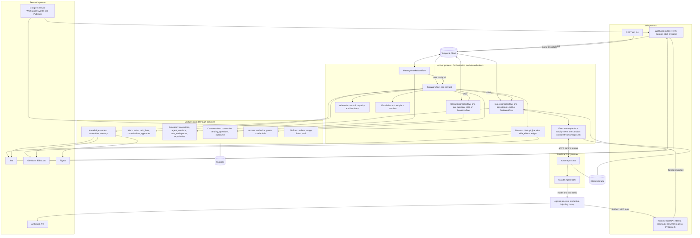
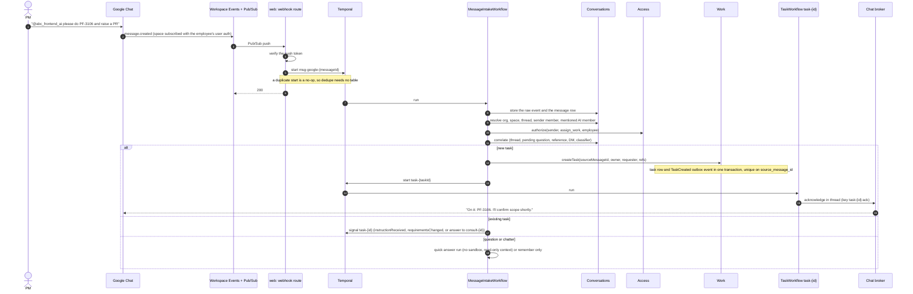
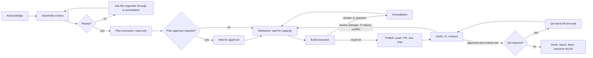
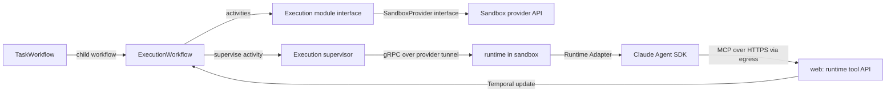
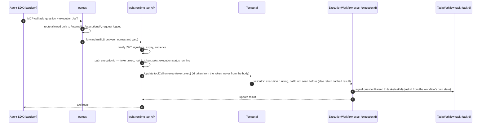
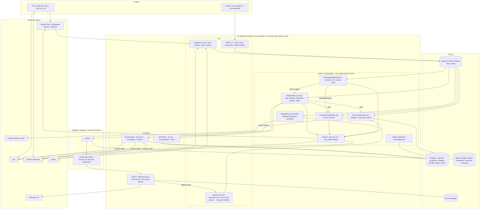

# Core Orchestrator Design

Status: **Approved direction** (2026-11-23), with the clarifications in §17 · Scope: design only, no implementation

This is the main document of a set of four:

| Document                                                   | Covers                                                                                                                                                                                                                                                            |
| ---------------------------------------------------------- | ----------------------------------------------------------------------------------------------------------------------------------------------------------------------------------------------------------------------------------------------------------------- |
| **core-orchestrator-design.md** (this file)                | Components, intake path, employee and task identification, context retrieval, Temporal coordination, contracts with the Execution module and the runtime, APIs, events, data entities, the contradiction register, and the decisions needed before implementation |
| [task-lifecycle.md](task-lifecycle.md)                     | Task state machine, planning and execution lifecycle, multiple tasks per employee, failures, retries and timeouts, the PR review feedback loop, QA hand-off                                                                                                       |
| [session-management.md](session-management.md)             | When to start or resume a Claude session, checkpoints, interrupted sessions, mid-run instructions, the runtime protocol                                                                                                                                           |
| [human-collaboration-flow.md](human-collaboration-flow.md) | Questions from Claude to PMs and engineers, answer routing, resuming paused workflows, reminders and escalation, approvals                                                                                                                                        |

## 0. Sources and labels

**Sources of truth:** the Claude Doc _AI Workforce Platform — PRD and Architecture_ and its Word exports in `docs/`:

| Short name | Document                    |
| ---------- | --------------------------- |
| PRD        | 1 · PRD                     |
| TA         | 2 · Technical architecture  |
| WD         | 3 · Workflow diagrams       |
| SS         | 4 · Service specifications  |
| EP         | 5 · Execution plan          |
| AR         | 6 · Architecture review     |
| IL         | 7 · Identity linking        |
| REF        | 8 · Architecture refinement |

**Labels used throughout:**

- **[Existing]** is a decision already made in the sources. Each one cites where it comes from, for example "TA §6".
- **[Proposed]** is an addition or change made by this design. Each one comes with its reasoning.
- **[Resolves C-n]** marks a proposal that settles contradiction _C-n_ from §16.
- **[Decision needed]** marks something a person must decide before implementation. These are gathered in §17.

**Constraints followed:**

- No new services, process roles or stores.
- All orchestrator code lives in the existing **Orchestration** module and runs in the **worker** process role. **[Existing]** TA §2, §3; AR SB-1, SB-9.
- No new database tables are proposed. Only columns are added to existing tables (§14).

---

## 1. What the Core Orchestrator is

**[Existing]** The orchestrator is not a service. It is the set of Temporal workflow definitions and activities in the Orchestration module, plus the brokers and the side-effect ledger (TA §2, §3). The principles it follows (TA §1, PRD §4):

- **Orchestrator coordinates, runtime executes.** Deterministic code owns state, side effects and policy. The Claude agent owns judgement inside a sandbox.
- **Temporal owns progress.** The `tasks` table is a read model written only by workflow activities, so there is a single writer (AR SB-4).
- **Every external write goes through a broker,** with an idempotency key recorded in `side_effects`.
- **Persistent employee, ephemeral execution.** Sessions, sandboxes and workspaces are disposable and rebuilt on demand.

**[Proposed]** The orchestrator has one more job, stated here so it has a single owner: it is the **only component that decides what happens next for a task**.

| Component    | What it does                            | What it does not do |
| ------------ | --------------------------------------- | ------------------- |
| Chat handler | Normalizes and routes messages          | Decides about work  |
| Runtime      | Reports results, questions and blockers | Decides about work  |
| Brokers      | Carry out external writes               | Decide about work   |

Why: today the "what next" logic is spread across TA §6 (TaskWorkflow steps), TA §8 (escalation engine), REF §A (serialization) and REF §C (ConsultationWorkflow). Naming one owner prevents two components from both retrying or both messaging a human.

---

## 2. Component view



### Component responsibilities

| Component                         | Responsibility                                                                                                                                                        | Owns (state)                                                                  | Label                                                                                                      |
| --------------------------------- | --------------------------------------------------------------------------------------------------------------------------------------------------------------------- | ----------------------------------------------------------------------------- | ---------------------------------------------------------------------------------------------------------- |
| Webhook routes (web)              | Verify signatures. Start `MessageIntakeWorkflow` for chat. Dedupe other webhooks in `inbound_deliveries` and signal the owning TaskWorkflow. Return 200 quickly       | Raw events in object storage                                                  | [Existing] TA §4, §5                                                                                       |
| MessageIntakeWorkflow             | Store, resolve, authorize, correlate, classify, route. Never decides about work                                                                                       | `messages`, `message_task_links`, `pending_questions` (through Conversations) | [Existing] TA §5; REF §B                                                                                   |
| TaskWorkflow                      | The brain for one task: readiness, planning, admission, executions, questions, publishing, verification, review loop, completion                                      | Temporal state; projection to `tasks`                                         | [Existing] TA §6; extended here                                                                            |
| ExecutionWorkflow                 | One attempt: acquire workspace, provision sandbox, start or resume the session, supervise, checkpoint, collect the result, tear down                                  | `executions`, `agent_sessions`, `task_workspaces` (through Execution)         | [Existing] TA §4, §6; REF §A                                                                               |
| ConsultationWorkflow              | One question to one human, with reminders, escalation and expiry                                                                                                      | `consultations` (Work), `pending_questions` (Conversations)                   | [Existing] REF §C; extended to all questions in [human-collaboration-flow.md](human-collaboration-flow.md) |
| Admission control                 | Per-employee and per-org caps on running executions, priority and fair share, the wake-up of queued work                                                              | Rows in `executions` with status `queued`                                     | [Proposed], details in [task-lifecycle.md §5](task-lifecycle.md)                                           |
| Escalation and recipient resolver | Picks who to ask: requester, repo or code owner, team lead, manager or PM. Applies the contact policy                                                                 | Reads `repository_owners`, `reporting_lines`, `org_units`, contact policy     | [Existing] TA §8; REF §C, F. Owner module assigned here [Resolves C-10]                                    |
| Brokers                           | Idempotent, policy-checked, audited external writes                                                                                                                   | `side_effects`                                                                | [Existing] TA §1, §4                                                                                       |
| Execution supervisor              | A long-running activity that holds the control stream to the runtime, relays heartbeats to Temporal, and reattaches after a worker restart                            | `executions.last_heartbeat_at`, last stream sequence number                   | [Proposed] [Resolves C-20]                                                                                 |
| Runtime tool API (web)            | Serves the platform's MCP tools to the agent through egress, authenticated by the execution JWT. Turns each tool call into a Temporal Update on the ExecutionWorkflow | Nothing persistent                                                            | [Proposed] [Resolves C-19]                                                                                 |
| Context assembler                 | Builds the task's context bundle from Jira, Figma, repositories, chat memory and org data, with the audience filter applied                                           | Bundle objects in object storage                                              | [Existing] TA §6, §14; AR SB-7 (owned by Knowledge)                                                        |

**Why a runtime tool API in web, not in worker:** worker processes are Temporal pollers with no inbound HTTP. Today TA §3 draws "egress → read-only tools → worker" without saying how. `web` already terminates inbound HTTP and already starts and signals workflows. Using Temporal **Updates** (a synchronous request to a running workflow) keeps every tool side effect inside the workflow's durable history. An `ask_question` tool call, for example, becomes part of the workflow's record instead of a stray database write.

**Why a supervisor activity:** TA §7 says the runtime "streams SDK messages to sandbox-manager over gRPC". But sandbox-manager is worker code (AR SB-9), and nothing says what happens to the stream when that worker restarts. Making the stream the body of a heartbeating activity gives this for free: Temporal reschedules the activity on another worker, and the new worker reattaches by `sandbox_ref` and resumes from the last sequence number saved in the heartbeat details. The sandbox keeps running throughout.

---

## 3. How a task travels from Google Chat to the orchestrator (responsibility 1)

**[Existing]** TA §4, §5; WD 5, 6; REF §B. The step numbers below match the diagram.



**Steps 13–15, the 10-second acknowledgement.** **[Existing]** PRD §6 requires an acknowledgement within 10 seconds. **[Proposed]** The acknowledgement is the **first activity** of TaskWorkflow, before any context assembly. Why: context building calls Jira, Figma and the knowledge index, which can take tens of seconds. Acknowledging first keeps the 10-second target independent of connector latency.

**Steps 10–12, intent classification.** **[Existing]** TA §5 and REF §B define the order: rules first, then a small structured model call. **[Proposed]**

- The classification call returns the **message type and the task correlation in one structured output**, so there is one model call per message, not two.
- Messages not addressed to the employee skip the classifier entirely (TA §14, "listen and remember").
- The full type list and its routing table are in §13.2.

**Edits and deletions.** **[Existing]** REF §B covers these. An edit to a message that a task has already acted on signals `requirementsChanged` with the diff.

---

## 4. Identifying the right AI employee and task (responsibility 2)

### 4.1 Which employee

**[Existing]** TA §5 and IL. Each check below is tried in order; the first that resolves wins.

| Signal                                        | Resolution                                                                                                |
| --------------------------------------------- | --------------------------------------------------------------------------------------------------------- |
| @mention annotation, Option B                 | Annotation `users/{id}` → `external_identities` (provider `google`, Chat user id) → `members` (type `ai`) |
| DM space, Option B                            | The DM space's other member → `members`                                                                   |
| Option A (Chat app fallback)                  | Persona name or slash command → `members`                                                                 |
| Reply in a thread bound to a task, no mention | The thread's task (`task_links.kind = thread`) → `tasks.owner_member_id`                                  |
| Jira webhook                                  | Issue key → `task_links.kind = jira_issue` → task → owner                                                 |
| GitHub or Bitbucket webhook                   | PR URL or branch → `task_links.kind = pull_request`, or `task_workspaces.branch` → task → owner           |

**Guards:**

- The resolved member must have `status = active`. A message to an employee in any other state gets a polite reply and is remembered only.
- Several AI employees mentioned in one message: one intake creates one link per employee. Each employee's tasks are correlated separately.

**[Proposed] Team-addressed work, such as "@frontend-team can someone take PF-3110?"** This is out of the MVP. In the MVP, a task has an owner only when an employee is named.

Why: TA §6 puts "employee selection" inside TaskWorkflow, yet the workflow id is `task-{id}` and the task row already carries `owner_member_id` when intake starts it. The workflow cannot select its own owner [C-9]. When this is added (Phase 4, with ProjectWorkflow), selection should be an activity in MessageIntakeWorkflow _before_ `createTask`. It would pick the best-fit active employee by role, team, capacity and grants (TA §6).

### 4.2 Which task

**[Existing]** REF §B, correlation order (first match wins):

1. Duplicate check: the workflow id equals the message id.
2. The thread is bound to a task.
3. The message replies to or quotes a pending question.
4. An explicit reference: Jira key, PR link or task id.
5. A DM with exactly one active task between this sender and this employee.
6. The classifier, over the employee's active tasks.
7. Ask in the thread which task is meant.

**[Proposed] precisions:**

- **Idempotent creation.** Add `tasks.source_message_id`, unique per org. SS ("unique constraint on source message id") and REF §A ("task creation is idempotent on the source message id") both rely on this, but the column is missing from TA §9 [C-14]. The task id is generated deterministically inside MessageIntakeWorkflow, so the same message always produces the same `task-{id}`.
- **A Jira key with no task, while the employee already has a closed task for that key:** create a new task linked to the old one with `task_links.kind = follows`. Why: closed tasks stay closed. This keeps outcome metrics (REF §G) per piece of work.
- **What the classifier sees:** only the titles, Jira keys and states of the _addressed employee's_ open tasks (REF §B security). It never sees other employees' tasks.

---

## 5. Retrieving Jira, Figma, GitHub and organizational context (responsibility 3)

**[Existing]**

- TA §6 and AR SB-7: the context assembler belongs to Knowledge; Orchestration calls it.
- TA §14: memory layers L0–L4 and the audience filter.
- TA §7: the bundle is mounted read-only at `/context`, and `CLAUDE.md` is rendered from memory and repository rules.
- SS: partial context is allowed, with flags.

### 5.1 Two-tier context: snapshot bundle plus live tools [Proposed]

| Tier                  | What                                                                                                                                     | When                                                                                                             | Why                                                                                                                                        |
| --------------------- | ---------------------------------------------------------------------------------------------------------------------------------------- | ---------------------------------------------------------------------------------------------------------------- | ------------------------------------------------------------------------------------------------------------------------------------------ |
| **Bundle** (snapshot) | A curated, versioned, permission-filtered set of documents written to object storage as `bundle-v{n}`, with a `manifest.json`            | Built before planning. Rebuilt on `requirementsChanged`, after each answered question, and before each fix round | Reproducible: every execution records exactly which bundle version it used. Makes audit ("why did you do that?") and replay tests possible |
| **Live tools**        | Read-only MCP tools inside the sandbox (`jira.read_issue`, `figma.get_node`, `figma.render`, `knowledge.search`), reached through egress | During execution, when the agent needs more depth than the bundle holds                                          | Bundles cannot anticipate every need. Tools let the agent drill in under the same grants, with every call logged                           |

### 5.2 What the bundle contains

| Source          | Content                                                                                                                                                                                                   | Fetched by                                                          | Limits and filtering                                                                                                                                                   |
| --------------- | --------------------------------------------------------------------------------------------------------------------------------------------------------------------------------------------------------- | ------------------------------------------------------------------- | ---------------------------------------------------------------------------------------------------------------------------------------------------------------------- |
| Jira            | The issue: summary, description, acceptance criteria, status, priority, labels. Comments, linked issues, sub-tasks, attachments (images rendered)                                                         | Connectors (`act-connectors` queue), with the employee's Jira grant | Only projects granted to the employee. Attachments capped by size                                                                                                      |
| Figma           | Frames and nodes linked from the ticket or the message: rendered PNGs, node tree summary, design tokens, component names                                                                                  | Connectors, with the org's Figma connection                         | Only files reachable through the connection and referenced by the task                                                                                                 |
| Repository      | From the registry (REF §F): default and target branch, build, test and lint commands, owners for likely paths, related repositories. Open PRs touching the same area. Recent commits on the target branch | Execution module (registry) and connectors                          | **No code in the bundle.** The agent reads code in its sandbox clone. This avoids stale copies and size limits                                                         |
| Conversation    | L0: the source thread in full, up to a token cap. L1: the space digest. L2: decisions and commitments related to the ticket or entities. L3: top retrieved snippets                                       | Knowledge                                                           | **Audience filter:** only sources whose audience covers everyone who will see the output. For a task, that means the source thread's audience plus PR readers (TA §14) |
| Organization    | Requester profile and their relationship to the employee, the team, the employee's manager, owners of likely paths, contact policy                                                                        | Workforce and Access                                                | Names and roles only. No private data                                                                                                                                  |
| Employee memory | L4 rules and lessons for this repo and team. Rendered into `CLAUDE.md`                                                                                                                                    | Knowledge                                                           | Curated items only                                                                                                                                                     |
| Task history    | Previous plan, last result, open questions and answers, review comments for a fix round, the task brief from the last checkpoint                                                                          | Work and Execution                                                  | —                                                                                                                                                                      |

**Assembly order and budget.** **[Existing]** TA §14: "most specific first", trimmed to a token budget. **[Proposed]** The bundle always includes `brief.md`, a one-page summary. The full documents are separate files the agent may open. Why: the agent's first prompt stays small; detail is pulled on demand.

**Failure behaviour:**

- A connector outage marks that source `unavailable` in the manifest.
- **[Proposed]** The readiness check then decides whether work can still start. A Figma outage, for example, blocks UI work but not a backend fix.
- **[Existing]** TA §12: if a required source is still down after its deadline, the task waits in `blocked` (dependency outage) and resumes automatically.

**Untrusted content.** **[Existing]** TA §11: everything external is labelled as data in the bundle and in tool results.

---

## 6. Planning and execution lifecycle (responsibility 4)

Specified in [task-lifecycle.md](task-lifecycle.md). Summary:



## 7. New session versus resumed session (responsibility 5)

Specified in [session-management.md](session-management.md). The rule in one line:

> **Resume** the task's current session when the next execution is for the same task and the same assignment, and the session is healthy, within retention, under the size limit, and on a compatible model and runtime. **Otherwise start a fresh session seeded with the task brief.** Never share a session across tasks or employees.

## 8. Multiple tasks per employee (responsibility 6)

Specified in [task-lifecycle.md §5](task-lifecycle.md):

- One TaskWorkflow per task.
- At most one execution per task.
- One branch lease per task and repository.
- **[Proposed]** Admission caps **running executions**, not open tasks [Resolves C-2].

## 9. Questions to humans and resuming paused workflows (responsibilities 7 and 8)

Specified in [human-collaboration-flow.md](human-collaboration-flow.md):

- **[Proposed]** Every question becomes a consultation [Resolves C-4]. This covers the readiness clarifications to the requester as well as mid-build questions to engineers.
- Answers signal the ConsultationWorkflow. The TaskWorkflow resumes when the child completes.

---

## 10. Temporal coordination (responsibility 11)

### 10.1 Workflow catalogue

| Workflow                                                                   | Id                                   | Started by                                          | Lifetime                                    | Children                                | Label                           |
| -------------------------------------------------------------------------- | ------------------------------------ | --------------------------------------------------- | ------------------------------------------- | --------------------------------------- | ------------------------------- |
| MessageIntakeWorkflow                                                      | `msg-{provider}-{externalMessageId}` | Webhook route                                       | Seconds                                     | —                                       | [Existing]                      |
| TaskWorkflow                                                               | `task-{taskId}`                      | Intake, delegation, meeting confirmation, dashboard | Hours to weeks (waits for review and merge) | ExecutionWorkflow, ConsultationWorkflow | [Existing]                      |
| ExecutionWorkflow                                                          | `exec-{executionId}`                 | TaskWorkflow                                        | Minutes to 90 minutes                       | —                                       | [Existing]                      |
| ConsultationWorkflow                                                       | `consult-{consultationId}`           | TaskWorkflow                                        | Hours to days                               | —                                       | [Existing] REF §C               |
| ProjectWorkflow                                                            | `project-{id}`                       | Project task                                        | Phase 4                                     | TaskWorkflows                           | [Existing]                      |
| OnboardingWorkflow, TerminationWorkflow, MeetingWorkflow, RepoSyncWorkflow | per REF                              | —                                                   | —                                           | —                                       | [Existing], outside this design |

**Why ExecutionWorkflow is a child workflow, not one long activity [Existing, reasoning added]:**

- An execution has its own steps: workspace, sandbox, session, supervise, checkpoint, teardown.
- It receives signals: `interrupt`, `deliverInstruction`.
- It receives tool Updates.
- Keeping those in a child keeps the TaskWorkflow history small and makes each attempt replayable on its own.

**Why ConsultationWorkflow is a child:** reminders, escalation hops and expiry are timer-heavy. Isolating them stops a slow human from bloating the task's history, and lets several questions run in parallel.

### 10.2 Signals, updates and queries

**[Existing]** TA §4 lists TaskWorkflow signals: `answerReceived`, `requirementsChanged`, `approvalDecided`, `prCommentAdded`, `ciStatusChanged`, `prMerged`, `dependencyResolved`, `cancel`, `reassign`.

**[Proposed]** The canonical list below. It reconciles WD and SS spellings [Resolves C-5]:

| Target               | Name                                             | Kind       | Sent by                                                                                                                                                   | Payload (summary)                                                         |
| -------------------- | ------------------------------------------------ | ---------- | --------------------------------------------------------------------------------------------------------------------------------------------------------- | ------------------------------------------------------------------------- |
| TaskWorkflow         | `instructionReceived`                            | signal     | Intake                                                                                                                                                    | messageId, linkType, text ref, sender, intent                             |
| TaskWorkflow         | `requirementsChanged`                            | signal     | Intake (edits, new requirement), Jira webhook (description changed)                                                                                       | source, diff ref                                                          |
| TaskWorkflow         | `approvalDecided`                                | signal     | Approvals API or card                                                                                                                                     | approvalId, decision, conditions                                          |
| TaskWorkflow         | `reviewSubmitted`                                | signal     | Git webhook (review submitted)                                                                                                                            | prRef, reviewId, state (approved, changes_requested, commented), reviewer |
| TaskWorkflow         | `prCommentAdded`                                 | signal     | Git webhook (single comment outside a review)                                                                                                             | prRef, commentId, author, path, line                                      |
| TaskWorkflow         | `ciStatusChanged`                                | signal     | Git webhook (check suite or run)                                                                                                                          | prRef, headSha, conclusion, failing checks                                |
| TaskWorkflow         | `prMerged` and `prClosed`                        | signal     | Git webhook                                                                                                                                               | prRef, mergedBy or closedBy                                               |
| TaskWorkflow         | `qaResult`                                       | signal     | Jira transition webhook or chat intake                                                                                                                    | result (passed, failed), notes ref                                        |
| TaskWorkflow         | `capacityGranted`                                | signal     | Admission release activity                                                                                                                                | executionId                                                               |
| TaskWorkflow         | `dependencyResolved`                             | signal     | Work (Phase 4)                                                                                                                                            | dependencyId                                                              |
| TaskWorkflow         | `questionRaised`                                 | signal     | ExecutionWorkflow (an `ask_question` tool call)                                                                                                           | executionId, question, blocking, suggestedOwner                           |
| TaskWorkflow         | `consultationClosed`                             | signal     | ConsultationWorkflow on completion; the backup path across the parent's continue-as-new ([human-collaboration-flow.md §7.1](human-collaboration-flow.md)) | consultationId, outcome, answer ref                                       |
| TaskWorkflow         | `cancel`, `reassign`, `retry`, `pause`, `resume` | **update** | REST API                                                                                                                                                  | actor, reason, newOwner                                                   |
| ConsultationWorkflow | `answerReceived`                                 | signal     | Intake (REF §B correlation)                                                                                                                               | messageId, answerer, text ref                                             |
| ConsultationWorkflow | `redirected`                                     | signal     | Intake ("ask Priya instead")                                                                                                                              | newRecipient                                                              |
| ExecutionWorkflow    | `interrupt`                                      | signal     | TaskWorkflow                                                                                                                                              | reason (cancel, revoke, newInstruction, shutdown)                         |
| ExecutionWorkflow    | `deliverInstruction`                             | signal     | TaskWorkflow                                                                                                                                              | text, source, urgency                                                     |
| ExecutionWorkflow    | `toolCall`                                       | **update** | Runtime tool API                                                                                                                                          | tool, args, callId                                                        |

**Why Updates for dashboard commands:** a cancel or reassign must say whether it was accepted ("task already done" or "accepted, interrupting"). A Temporal Update validates against the workflow's own state and returns the answer synchronously, with no read-then-signal race against the `tasks` projection.

**Why no Temporal Queries in hot paths:** the dashboard reads the `tasks` projection and `executions`, not workflow state. Queries are kept for operators' debugging.

**`answerReceived` is renamed in meaning.** **[Existing]** TA §4 lists `answerReceived` on TaskWorkflow, and WD 11 calls it `clarification_answered`. **[Proposed]** It moves to ConsultationWorkflow. TaskWorkflow learns about answers through child completion, or through a forwarded `deliverInstruction` for non-blocking questions. See [human-collaboration-flow.md §4](human-collaboration-flow.md).

### 10.3 Task queues [Existing principle, names proposed]

TA §12 calls for separate queues for model calls, connector calls and sandbox control.

| Queue            | Runs                                                   | Why separate                                              |
| ---------------- | ------------------------------------------------------ | --------------------------------------------------------- |
| `wf`             | Workflow tasks only                                    | Workflow progress never waits behind slow activities      |
| `act-db`         | Module activities: DB writes, outbox, authorize        | Fast and frequent                                         |
| `act-connectors` | Jira, Figma, Git and Google reads                      | Provider rate limits; can be throttled per provider       |
| `act-model`      | Classifier, readiness check, quick answers, extraction | Model rate limits and cost                                |
| `act-sandbox`    | Provision, supervise, checkpoint, destroy              | Long-running and heartbeating. Sized by the sandbox quota |
| `act-brokers`    | Chat, git and Jira writes                              | Must never be starved by reads. Ordered retries           |

### 10.4 Durability rules

**[Existing]** TA §4, §6, §13:

- Deterministic workflow code. All I/O happens in activities.
- Continue-as-new after a set number of events, passing object-storage references.
- Worker versioning for deploys.
- Watchdog timers per step.

**[Proposed]**

- **Projection writes.** Each state transition runs one `recordTaskState(taskId, from, to, version)` activity. It updates `tasks.state` and writes `TaskStateChanged` to the outbox in one transaction. `tasks.state_version` must equal the workflow's counter, so stale replays are no-ops.
- **Continue-as-new carry-over.** The workflow carries a small state object across: state, attempt counters, open consultation ids, current execution id, last bundle version, review round, PR ref. Everything else is in Postgres or object storage.
- **Parent close policy.** Execution children use `REQUEST_CANCEL`, so cancelling a task interrupts the running attempt and lets it checkpoint. Consultation children use `ABANDON` plus an explicit "close consultation" activity, so the human gets a "no longer needed" message.
- **Patching** (`getVersion`) is used for in-flight changes to TaskWorkflow logic. Tasks can live for weeks, so old histories must keep replaying.

---

## 11. Communication with the Execution module and the Claude Agent SDK runtime (responsibility 12)

### 11.1 Layers



### 11.2 Execution module interface (TypeScript, called only from activities)

**[Existing]**

- REF §A: `acquireWorkspace`, `checkpoint`, `restore`, `releaseWorkspace`.
- SS: `admit`, `start`, `heartbeat`, `interrupt`, `terminate`.

**[Proposed]** Consolidated contract:

```text
admit(taskId, kind, priority) -> { executionId, status: "admitted" | "queued", queuePosition? }
releaseSlot(executionId) -> { nextExecutionId? }            // caller signals that task's workflow
acquireWorkspace(taskId, repoId, executionId) -> { workspaceId, branch, baseSha, snapshotUri?, leaseExpiresAt }
renewLease(workspaceId, executionId) -> { leaseExpiresAt }
provisionSandbox(executionId, imageRef, limits) -> { sandboxRef, endpoint }
startRuntime(executionId, sandboxRef, StartSpec) -> { runtimeSessionId }
superviseExecution(executionId, sandboxRef, fromSeq) -> ExecutionResult   // long-running, heartbeats
interrupt(executionId, reason) -> void
checkpoint(executionId, reason) -> { snapshotUri, sessionUri, briefUri, commitSha }
destroySandbox(sandboxRef) -> void                         // idempotent
recordResult(executionId, ExecutionResult) -> void
```

### 11.3 StartSpec (orchestrator → runtime)

This extends the SS example "start an execution". New fields are marked **P**.

| Field                                                                     | Meaning                                                                                                                                            |
| ------------------------------------------------------------------------- | -------------------------------------------------------------------------------------------------------------------------------------------------- |
| executionId, taskId, orgId, employeeId                                    | Identity and scope                                                                                                                                 |
| kind                                                                      | `plan`, `build`, `fix`, `review_reply`, `answer` (P: `review_reply`)                                                                               |
| runtime, model                                                            | `claude-agent-sdk`, `claude-opus-5-5` (TA §13)                                                                                                     |
| image, repo {provider, name, baseBranch, workBranch}                      | Environment                                                                                                                                        |
| contextBundle                                                             | `obj://…/bundle-v{n}`                                                                                                                              |
| session {mode: `new` \| `resume`, sessionId?, sessionUri?, seedBriefUri?} | P: the explicit decision from [session-management.md](session-management.md)                                                                       |
| instruction                                                               | P: the task prompt for this execution, for example "Implement the approved plan", "Address review round 2: …", "The answer to your question was …" |
| allowedTools                                                              | From the task's effective permissions (TA §11). **No write tools for git** [Resolves C-6]                                                          |
| platformTools                                                             | P: `ask_question`, `report_progress`, `record_blocker`, `request_scope_change`, `get_context_item`                                                 |
| limits {wallClockSec, maxTurns, budgetUsd}                                | Existing                                                                                                                                           |
| checkpointPolicy {onPlanStep: true, maxIntervalSec: 600}                  | P: from REF §A                                                                                                                                     |

### 11.4 ExecutionResult (runtime → orchestrator, from `result.json`)

**[Existing]** TA §7: the agent writes `result.json`. TA §8: structured blockers. **[Proposed]** schema:

| Field          | Meaning                                                                                                                                          |
| -------------- | ------------------------------------------------------------------------------------------------------------------------------------------------ |
| status         | `completed` · `blocked` (needs answers) · `cannot_complete` · `limit_reached` (turns, time or budget) · `interrupted` · `failed` (runtime error) |
| summary        | What was done, for the thread and the PR description                                                                                             |
| commits        | Local commits: sha, message (never pushed by the agent)                                                                                          |
| tests          | Commands run, pass or fail counts, artifacts                                                                                                     |
| evidence       | Screenshot and report URIs in object storage                                                                                                     |
| planProgress   | Steps done, remaining, current step                                                                                                              |
| questions[]    | Each with: kind (information, decision, requirement), text, why it blocks, suggested owner, blocking (bool), whatICanDoMeanwhile                 |
| scopeChanges[] | Work found to be outside the plan or the grants                                                                                                  |
| confidence     | 0–1, with reasons. Below the threshold means hand back (PRD §4)                                                                                  |
| checkpoint     | The final checkpoint references                                                                                                                  |

### 11.5 Runtime control protocol (supervisor ↔ runtime, gRPC)

**[Existing]** SS lists `Start`, `Resume`, `Send`, `Interrupt`, `Stream`. **[Proposed]** add `Checkpoint` and `Health`, and define stream reattachment:

| RPC                           | Direction | Purpose                                                                                                                                                                                          |
| ----------------------------- | --------- | ------------------------------------------------------------------------------------------------------------------------------------------------------------------------------------------------ |
| `Start(StartSpec)`            | sup → rt  | Start a new or resumed session                                                                                                                                                                   |
| `Send(text, source)`          | sup → rt  | Inject a mid-run instruction as streaming user input                                                                                                                                             |
| `Interrupt(reason, graceSec)` | sup → rt  | Stop at the next safe point, checkpoint, exit with `interrupted`                                                                                                                                 |
| `Checkpoint(reason)`          | sup → rt  | Force a checkpoint (before planned shutdown)                                                                                                                                                     |
| `Health()`                    | sup → rt  | Liveness and current step                                                                                                                                                                        |
| `Stream(fromSeq)`             | rt → sup  | Ordered events: progress, tool_call, tool_result, cost, checkpoint_written, question_raised, finished. **Resumable from `fromSeq`**: the runtime buffers events on local disk until acknowledged |

**Platform tools (MCP via egress → web).** Each call is a `toolCall` Update on `exec-{id}`. Examples:

- `ask_question` records the question and returns `{consultationId}`. The orchestrator forwards it to TaskWorkflow; see the collaboration doc.
- `report_progress` becomes telemetry only.

**Why this split:**

- **Control** (start, stop, inject) goes worker → sandbox, owned by the supervisor.
- **Requests that need platform decisions** go sandbox → web → workflow, so they are recorded durably.
- **Bulk telemetry** goes to `execution_logs` and object storage and never triggers business logic (TA §4).

---

## 12. API contracts

### 12.1 REST (web, /v1, org-scoped; conventions in TA §10)

| Method and path                                             | Purpose                                                                | Label                                      |
| ----------------------------------------------------------- | ---------------------------------------------------------------------- | ------------------------------------------ |
| GET `/v1/orgs/{org}/tasks/{id}`                             | Task with executions, consultations, approvals, links                  | [Existing] TA §10                          |
| GET `/v1/orgs/{org}/tasks/{id}/timeline`                    | Merged view: state changes, messages, executions, questions, PR events | [Proposed]                                 |
| POST `/v1/orgs/{org}/tasks/{id}:cancel`                     | Update `cancel` → `{accepted, state}`                                  | [Proposed] replaces SS "PATCH /tasks/{id}" |
| POST `/v1/orgs/{org}/tasks/{id}:reassign` `{ownerMemberId}` | Update `reassign`                                                      | [Proposed]                                 |
| POST `/v1/orgs/{org}/tasks/{id}:retry` `{fromState?}`       | Restart from a handed-back or blocked state                            | [Proposed]                                 |
| POST `/v1/orgs/{org}/tasks/{id}:pause` / `:resume`          | Manager control; a running attempt checkpoints and stops               | [Proposed]                                 |
| GET `/v1/orgs/{org}/executions/{id}/events`                 | SSE progress                                                           | [Existing]                                 |
| GET `/v1/orgs/{org}/tasks/{id}/consultations`               | Questions and answers                                                  | [Existing] REF §C                          |
| POST `/v1/orgs/{org}/consultations/{id}:answer` `{text}`    | Answer from the dashboard (fallback channel)                           | [Proposed]                                 |
| POST `/v1/orgs/{org}/approvals/{id}:decide`                 | Approve or reject                                                      | [Existing]                                 |
| GET `/v1/orgs/{org}/employees/{id}/queue`                   | Running and queued executions, with estimated waits                    | [Proposed]                                 |

Example, cancel:

```json
POST /v1/orgs/org_01J/tasks/tsk_01J:cancel
Idempotency-Key: 0c6e…
{ "reason": "Requirement dropped by product" }

200 OK
{ "taskId": "tsk_01J", "accepted": true, "state": "cancelling",
  "effects": ["interrupting exe_01J7", "closing 1 open consultation"] }
```

### 12.2 Internal runtime tool API (web, reachable only from egress) [Proposed]

`POST /internal/v1/executions/{executionId}/tools/{tool}`

- **Auth:** the per-execution JWT (TA §5, "AI runtime identity"), checked against `executionId`.
- **Body:** `{callId, args}`. `callId` makes retries idempotent.
- **Result:** the Update's return value. Timeout 30 s.

Example, `ask_question`:

```json
{ "callId": "c-17",
  "args": { "kind": "decision", "blocking": true,
    "text": "PF-3106 says 'show last login'. Should this be relative ('2 days ago') or absolute in the user's timezone?",
    "why": "Both formats exist in the codebase; the Figma frame shows a placeholder.",
    "suggestedOwner": "requester",
    "meanwhile": "I'll build the card layout and tests with relative time behind one formatter." } }
→ { "consultationId": "con_01J…", "mode": "blocking", "expectedResponse": "within working hours" }
```

---

## 13. Events and message flows

### 13.1 Outbox events written by orchestrator activities

**[Existing]** TA §4 and REF:

- TaskCreated, TaskAssigned, TaskStateChanged, TaskCompleted, TaskHandedBack
- ClarificationRequested, ClarificationAnswered
- ApprovalRequested, ApprovalDecided
- ExecutionStarted, ExecutionFinished
- PullRequestOpened, MessageSent
- TaskQueuedForCapacity, TaskWorkspaceRecovered
- ConsultationRequested, ConsultationAnswered, ConsultationEscalated, ConsultationExpired
- TaskOutcomeRecorded

**[Proposed] additions** (each has one writer):

| Event                                    | Writer              | Consumers                                                                       | Why                                                                                  |
| ---------------------------------------- | ------------------- | ------------------------------------------------------------------------------- | ------------------------------------------------------------------------------------ |
| PlanCreated                              | Work (`recordPlan`) | Dashboard, audit                                                                | Named in SS but missing from TA §4                                                   |
| ReviewRoundStarted, ReviewRoundCompleted | Work                | Quality metrics (REF §G "PR acceptance within two rounds", "review turnaround") | The metrics need round boundaries                                                    |
| TaskQaRequested, TaskQaResulted          | Work                | Notifications, metrics ("qa.reopened" in REF §G)                                | No QA events exist today [C-15]                                                      |
| ExecutionInterrupted                     | Execution           | Usage, audit                                                                    | An interruption is not a failure, so it should not count against reliability metrics |
| ConsultationWithdrawn                    | Work                | Metrics, audit                                                                  | The agent found the answer itself; the person is told "never mind"                   |

**[Proposed] naming rule** [Resolves C-5]: TA §4 is the canonical event list. These names in WD and SS are aliases to remove at the next doc revision:

| Remove (alias)                                           | Use instead (canonical)                                                                                      |
| -------------------------------------------------------- | ------------------------------------------------------------------------------------------------------------ |
| EmployeeNeedsClarification                               | ConsultationRequested {kind: clarification}                                                                  |
| ClarificationRequested, ClarificationAnswered (TA §4)    | ConsultationRequested and ConsultationAnswered {kind: clarification}, since every question is a consultation |
| PullRequestCreated                                       | PullRequestOpened                                                                                            |
| ApprovalGranted, ApprovalRejected, ApprovalExpired       | ApprovalDecided {decision}                                                                                   |
| AIEmployeeCreated, EmployeeSuspended, EmployeeTerminated | MemberHired, MemberSuspended, MemberTerminated                                                               |
| ExecutionProgressUpdated                                 | Telemetry, not an event                                                                                      |
| ChatMessageReceived, MessageClassified                   | Conversation events MessageCorrelated and MessageCorrelationAmbiguous (REF §B)                               |

### 13.2 Message type routing (intake output) [Proposed]

This refines TA §5 "classify" and FR-COM-2.

| Type             | Detected by                                                   | Route                                                                                     |
| ---------------- | ------------------------------------------------------------- | ----------------------------------------------------------------------------------------- |
| new_work_request | Rules (unbound thread plus new key or imperative), then model | `createTask`; if the sender lacks `assign_work`, ask the employee's manager to confirm    |
| task_update      | Thread, reference, model                                      | `instructionReceived` or `requirementsChanged`                                            |
| answer           | pending_question match (REF §B)                               | `answerReceived` → `consult-{id}`                                                         |
| approval         | Card action                                                   | `approvalDecided`                                                                         |
| status_question  | Rules ("status?", "how's PF-3106"), model                     | Answer from the `tasks` projection and the last execution summary. No sandbox, no session |
| general_question | Model                                                         | Quick answer run: read-only context, no sandbox (TA §14)                                  |
| control          | Rules ("stop", "pause", "cancel PF-3106")                     | Same Update as the REST action, with sender authorization                                 |
| feedback         | Thread bound to a done task, model                            | Remember; if it asks for a change, a new linked task (`follows`)                          |
| chatter          | Rules (thanks, emoji), model                                  | Remember only, or a short acknowledgement (REF §B)                                        |
| out_of_scope     | Model, policy                                                 | Polite reply. Escalate to the manager if it needs a human                                 |

---

## 14. Database entities

**[Existing]** tables used by the orchestrator (TA §9, REF): `tasks`, `task_links`, `approvals`, `side_effects`, `executions`, `execution_logs`, `agent_sessions`, `task_workspaces`, `repositories`, `repository_owners`, `consultations`, `pending_questions`, `message_task_links`, `messages`, `outbox_events`, `inbound_deliveries`, `usage_records`, `org_limits`, `ai_profiles`, `task_outcomes`.

**[Approved] column additions. No new tables.**

| Table                                  | Add                                                                                                                                                                                                  | Why                                                                                                                |
| -------------------------------------- | ---------------------------------------------------------------------------------------------------------------------------------------------------------------------------------------------------- | ------------------------------------------------------------------------------------------------------------------ |
| tasks                                  | `source_message_id` (unique per org, nullable)                                                                                                                                                       | Idempotent creation [C-14]                                                                                         |
| tasks                                  | `priority` (int), `assignment_no` (int, starts at 1), `state_version` (int)                                                                                                                          | Admission order. Sessions tied to the assignment [C-13]. Single-writer projection                                  |
| tasks                                  | `state` enum aligned to [task-lifecycle.md §2](task-lifecycle.md)                                                                                                                                    | [C-3]                                                                                                              |
| tasks                                  | `pr_review_round` (int), `attempt_count` (int)                                                                                                                                                       | Loop limits and metrics                                                                                            |
| task_links                             | `kind` adds `follows`; index on (org_id, kind, external_ref)                                                                                                                                         | Webhook → task lookup                                                                                              |
| executions                             | `kind` adds `review_reply`; `status` adds `queued`, `interrupted`; `priority`, `bundle_version`, `session_mode` (new or resume), `result_uri`, `exit_reason`, `last_heartbeat_at`, `last_stream_seq` | Admission, audit, reattach                                                                                         |
| agent_sessions                         | `assignment_no`, `generation`, `parent_session_id`, `sdk_version`, `brief_uri`, `token_estimate`, `compactions`, `last_checkpoint_at`, `status` (active, idle, expired, superseded, corrupt)         | Session decisions ([session-management.md §6](session-management.md))                                              |
| consultations                          | `kind` (clarification, consultation), `question_kind`, `blocking`, `meanwhile`, `safe_default`, `execution_id`, `batch_id`, `escalation_level`, `answer_outcome`, `answered_by_member_id`            | One mechanism for all questions [C-4]. Full list in [human-collaboration-flow.md §11](human-collaboration-flow.md) |
| pending_questions                      | `consultation_id`                                                                                                                                                                                    | Links the routing record (Conversations) to the business record (Work)                                             |
| ai_profiles                            | `max_concurrency` (exists); add `max_open_tasks` (nullable)                                                                                                                                          | Optional cap on work in progress; see D-2 in §17                                                                   |
| tasks                                  | `settings_snapshot` jsonb                                                                                                                                                                            | Completion criteria, QA and review limits pinned at creation (§18.1)                                               |
| organizations, org_units, repositories | `settings` jsonb (versioned; `org_units.settings.contact_policy`)                                                                                                                                    | Configurable policies (§18)                                                                                        |
| members                                | `onboarding_checks` jsonb (versioned)                                                                                                                                                                | REF §E checks (D-13)                                                                                               |
| audit_logs                             | `details_uri`                                                                                                                                                                                        | Before-and-after documents for settings changes (§18.2)                                                            |

---

## 15. Failure scenarios (summary)

The full table is in [task-lifecycle.md §6](task-lifecycle.md). The orchestrator's three guarantees:

1. **No lost task.** Workflow id = task id. The webhook route returns 200 only after the start or signal is accepted by Temporal. Thread reconcile polling recovers missed chat events (TA §12).
2. **No duplicate external effect.** The `side_effects` key is deterministic per task and step (for example `task:{id}:pr`, `task:{id}:msg:q:{consultationId}`), with check-before-create (TA §4).
3. **No silent stall.** Every waiting state has a timer: reminder, escalation, watchdog. Every running state has a heartbeat.

---

## 16. Contradictions and missing decisions in the existing documentation

Each row cites the conflicting sources and its resolution. **All 24 resolutions were accepted on 2026-11-23** and applied to PRD, TA, WD, SS and REF in the same pass (see each tab's "Core Orchestrator synchronization" note).

| ID   | Issue                                                                                                                                                                                                           | Where                         | Resolution (accepted)                                                                                                                                                                     |
| ---- | --------------------------------------------------------------------------------------------------------------------------------------------------------------------------------------------------------------- | ----------------------------- | ----------------------------------------------------------------------------------------------------------------------------------------------------------------------------------------- |
| C-1  | Identity tables named `ai_employees` and `employee_identities` in the six-identities table, but `members`, `ai_profiles` and `external_identities` in the data model                                            | TA §5 vs TA §9, IL §5         | Use TA §9 names everywhere                                                                                                                                                                |
| C-2  | Concurrency cap: "default 2 **tasks**" vs "caps active **executions**"                                                                                                                                          | TA §7 vs REF §A               | Cap running executions; optional `max_open_tasks` (§14). See [task-lifecycle.md §5](task-lifecycle.md)                                                                                    |
| C-3  | Task states: the enum has no `queued`, no mid-build waiting state, an unclear `assigned`; WD 8 uses different names                                                                                             | TA §9, REF §A, C, WD 8        | One enum in [task-lifecycle.md §2](task-lifecycle.md), with a mapping table                                                                                                               |
| C-4  | Where answers go: `answerReceived` on TaskWorkflow (WD 11 calls it `clarification_answered`) vs ConsultationWorkflow                                                                                            | TA §4, WD 11 vs REF §C        | All questions are consultations; answers signal the consultation                                                                                                                          |
| C-5  | Signal and event names differ across docs                                                                                                                                                                       | TA §4 vs WD 10, 11, 14 vs SS  | Canonical lists in §10.2 and §13.1                                                                                                                                                        |
| C-6  | Who pushes the branch: the agent through `mcp__git__publish` during execution, or the TaskWorkflow broker after the execution                                                                                   | TA §7, SS example vs WD 7, 10 | TaskWorkflow publishes after the result is accepted. The agent has no git write tool. Why: one place for policy and idempotency, and a natural verification point                         |
| C-7  | Workspace lifetime: "per execution, rebuilt from image" vs "snapshot only if follow-up expected" vs "per-task snapshot every 10 minutes"; checkpoint cadence "every N turns" vs "each plan step and 10 minutes" | PRD §3, TA §7, SS vs REF §A   | REF §A wins: a per-task checkpoint (git bundle plus session files) at each plan step and at least every 10 minutes; a fresh sandbox per execution                                         |
| C-8  | WD 14 shows "Policy (Cedar)"                                                                                                                                                                                    | WD 14 vs AR SB-8              | `authorize()` in the MVP; fix the diagram label                                                                                                                                           |
| C-9  | "Employee selection" inside TaskWorkflow, but the task already has an owner when the workflow starts                                                                                                            | TA §6                         | Selection moves to intake, before `createTask`; Phase 4                                                                                                                                   |
| C-10 | The escalation engine belongs to the "collaboration module" (a Phase 4 logical service), but consultations are Phase 3 in Work                                                                                  | TA §8 vs REF §C, SS           | Escalation and recipient resolution are Work module code, called by TaskWorkflow, in Phase 3                                                                                              |
| C-11 | ProvisionWorkflow still listed under core orchestration                                                                                                                                                         | SS                            | Remove (superseded by IL)                                                                                                                                                                 |
| C-12 | `onboarding_checks` used but not counted among the 41 tables; contact policy "on org_units" has no column                                                                                                       | REF §E, C vs TA §9            | Versioned JSONB columns: `members.onboarding_checks` and the `contact_policy` key in `organizations.settings` / `org_units.settings`, with schema validation, revisions and audit (§18.2) |
| C-13 | "Task assignment" is a PRD entity, and sessions span an assignment, but nothing stores assignments                                                                                                              | PRD §3 vs TA §9               | `tasks.assignment_no` and `agent_sessions.assignment_no`; history in TaskAssigned events                                                                                                  |
| C-14 | Creation is "unique on source message id" but no such column exists                                                                                                                                             | SS, REF §A vs TA §9           | Add `tasks.source_message_id`                                                                                                                                                             |
| C-15 | QA: state `in_qa` and metric "qa.reopened", but no QA hand-off flow, signal or completion criterion                                                                                                             | TA §9, REF §G, PRD §2         | [task-lifecycle.md §8](task-lifecycle.md); QA is an optional completion criterion                                                                                                         |
| C-16 | Meetings "from Phase 5" in the context section                                                                                                                                                                  | TA §14 vs REF (Phase 3)       | Phase 3                                                                                                                                                                                   |
| C-17 | Approval wait expiry "counts as rejection", but readiness and plan approvals have no default approvers                                                                                                          | TA §8                         | Plan approval off by default; approver = requester's manager when on                                                                                                                      |
| C-18 | Per-task budget exists in two places (`tasks.budget_usd`, `org_limits.per_task_budget_usd`) with no precedence                                                                                                  | TA §9                         | Effective = min(task, org)                                                                                                                                                                |
| C-19 | Platform MCP tools reach "worker" through egress, but worker has no inbound endpoint                                                                                                                            | TA §3                         | Runtime tool API in web → Temporal Update (§2)                                                                                                                                            |
| C-20 | The runtime progress stream is owned by worker code, with no behaviour defined on worker restart                                                                                                                | TA §7, SS                     | Supervisor activity with resumable stream (§2, §11.5)                                                                                                                                     |
| C-21 | "Up to 2 automatic retries" but no per-task attempt cap, and no rule for loops between review fixes and CI fixes                                                                                                | TA §6                         | Limits in [task-lifecycle.md §6.3](task-lifecycle.md)                                                                                                                                     |
| C-22 | Review loop has no batching, round limit, reviewer filter or bot handling                                                                                                                                       | TA §6, PRD FR-ENG-4           | [task-lifecycle.md §7](task-lifecycle.md)                                                                                                                                                 |
| C-23 | "Pass a small change into the running session" with no definition of small                                                                                                                                      | REF §A                        | [session-management.md §5](session-management.md)                                                                                                                                         |
| C-24 | Tasks waiting for merge can stay open for days; unclear whether they hold capacity, sessions or sandboxes                                                                                                       | —                             | They hold none: no sandbox, idle session, no execution slot                                                                                                                               |

---

## 17. Approved decisions (2026-11-23)

Every recommended default from the review was approved, with the clarifications below. "Configurable" means the value is a default that can be overridden at the scopes listed in §18.

| #    | Decision                                        | Approved value                                                                                                                                                                                               | Configurable?                                                    | Where specified                                               |
| ---- | ----------------------------------------------- | ------------------------------------------------------------------------------------------------------------------------------------------------------------------------------------------------------------ | ---------------------------------------------------------------- | ------------------------------------------------------------- |
| D-1  | Contradiction resolutions C-1 to C-24           | All accepted; source docs synchronized                                                                                                                                                                       | —                                                                | §16                                                           |
| D-2  | Capacity unit                                   | Running executions. `ai_profiles.max_concurrency` = 2; optional `ai_profiles.max_open_tasks` = 6                                                                                                             | Per employee                                                     | [task-lifecycle.md §5.2](task-lifecycle.md)                   |
| D-3  | Publishing code                                 | The orchestrator publishes through the git broker after an execution finishes. **The agent has no git write or publish permission**: read-only repo tokens, no git write tool, and egress denies push routes | No                                                               | §19.5                                                         |
| D-4  | Human questions                                 | Every human question uses ConsultationWorkflow. Approvals are authorizations, not questions, and keep their own flow (TA §8)                                                                                 | —                                                                | [human-collaboration-flow.md §2](human-collaboration-flow.md) |
| D-5  | Task state machine                              | Canonical enum adopted                                                                                                                                                                                       | No                                                               | [task-lifecycle.md §2](task-lifecycle.md)                     |
| D-6  | Completion criteria                             | Default: `pr_opened`, `ci_green`, `pr_approved`, `pr_merged`. QA (`qa_passed`) is optional                                                                                                                   | Per org, team, repository                                        | §18.1                                                         |
| D-7  | Plan approval                                   | Off by default; on for sensitive repositories or paths                                                                                                                                                       | Per org, team, repository, path                                  | §18.1                                                         |
| D-8  | Session resume policy                           | Idle ≤ 7 days, context < 60 % of the window, ≤ 3 compactions, same model family and SDK major version, fresh after hand-back                                                                                 | Per org, team                                                    | [session-management.md §3.2](session-management.md)           |
| D-9  | Review loop limits                              | 3-minute debounce; escalate after round 4; actionable reviewers = humans with repo write access or listed owners, plus the requester                                                                         | Per org, team, repository                                        | [task-lifecycle.md §7](task-lifecycle.md)                     |
| D-10 | Retry and timeout policies                      | As tabled                                                                                                                                                                                                    | Human-facing timers per org; engine limits are platform defaults | [task-lifecycle.md §6](task-lifecycle.md)                     |
| D-11 | Correlation confidence threshold                | 0.75 (initial)                                                                                                                                                                                               | Per org                                                          | §13.2                                                         |
| D-12 | Contact policy                                  | Threads first. DM only the requester or the asked owner. At most 3 open questions per person per day. Respect working and quiet hours                                                                        | Per org, team                                                    | [human-collaboration-flow.md §4](human-collaboration-flow.md) |
| D-13 | Storage of onboarding checks and contact policy | Versioned JSONB columns with validation, revisions and audit                                                                                                                                                 | —                                                                | §18.2                                                         |
| D-14 | Phase 0 additions                               | Worker-restart reconnection (S3) and runtime tool → workflow path (S6); written into the Execution plan's pass conditions                                                                                    | —                                                                | §19.4, §19.2                                                  |
| D-15 | Hand-back confidence threshold                  | 0.6 (initial)                                                                                                                                                                                                | Per org                                                          | [task-lifecycle.md §3.3](task-lifecycle.md)                   |

---

## 18. Configuration model

### 18.1 Configurable policies and resolution order

**Resolution order (most specific wins):**

1. Repository
2. Team: the nearest `org_unit` ancestor of the employee, walking up the tree
3. Organization
4. Platform default

| Key                                                                                                                                          | Scopes                                  | Default                                               | Read when                        |
| -------------------------------------------------------------------------------------------------------------------------------------------- | --------------------------------------- | ----------------------------------------------------- | -------------------------------- |
| `completion.criteria`                                                                                                                        | org, team, repository                   | `[pr_opened, ci_green, pr_approved, pr_merged]`       | **Pinned** at task creation      |
| `qa.required`, `qa.stage` (`pre_merge` or `post_merge`), `qa.owner`                                                                          | team, repository                        | `false`                                               | Pinned at task creation          |
| `plan_approval.required`                                                                                                                     | org, team, repository                   | `false`                                               | Pinned at task creation          |
| `plan_approval.sensitive_repository`                                                                                                         | repository                              | `false` (when `true`, plan approval is required)      | Pinned at task creation          |
| `plan_approval.sensitive_paths`                                                                                                              | org, repository                         | `[]` (globs; a plan touching a match needs approval)  | At plan acceptance               |
| `session.max_idle_days`, `session.max_context_ratio`, `session.max_compactions`, `session.fresh_after_handback`                              | org, team                               | 7, 0.6, 3, `true`                                     | At each session decision         |
| `review.debounce_seconds`, `review.max_rounds_before_escalation`, `review.actionable_reviewers`                                              | org, team, repository                   | 180, 4, `repo_write_or_owner`                         | Pinned at task creation          |
| `correlation.confidence_threshold`                                                                                                           | org                                     | 0.75                                                  | Per message                      |
| `handback.confidence_threshold`                                                                                                              | org                                     | 0.6                                                   | Per result                       |
| `contact_policy` (allowed roles, quiet hours, per-person daily cap, channel preference, DM rules, reminder, escalation and expiry durations) | org, team                               | Per D-12 and REF §C                                   | At each consultation timer event |
| `timeouts.approval_expiry`, `timeouts.review_nudge`, `timeouts.qa_reminder`                                                                  | org                                     | Per [task-lifecycle.md §6.2](task-lifecycle.md)       | At each timer start              |
| Engine limits: wall clocks, heartbeats, leases, retry budgets                                                                                | Platform                                | Per [task-lifecycle.md §6.2, §6.3](task-lifecycle.md) | Deploy-time config               |
| `max_concurrency`, `max_open_tasks`                                                                                                          | Per employee (columns on `ai_profiles`) | 2, 6                                                  | At admission                     |

**Why pin some values at task creation:** completion criteria, QA and review limits define "what done means" for a task. Changing them while a PR is in review would surprise everyone. The resolved values are copied to `tasks.settings_snapshot` when the task is created. People-facing timers (contact policy, nudges) stay live, so a quiet-hours change takes effect at the next timer event.

### 18.2 Versioned JSONB settings [Approved D-13]

**Columns (no new tables):**

- `organizations.settings jsonb`
- `org_units.settings jsonb` (includes `contact_policy`)
- `repositories.settings jsonb`
- `members.onboarding_checks jsonb`
- `tasks.settings_snapshot jsonb`
- `audit_logs.details_uri text`

**Document shape:**

```json
{
  "schema": "team_settings@1",
  "revision": 7,
  "updatedAt": "2026-11-23T10:02:00Z",
  "updatedBy": "mem_01J…",
  "value": {
    "completion": { "criteria": ["pr_opened", "ci_green", "pr_approved", "pr_merged"] },
    "contact_policy": { "quietHours": "19:00-09:00", "maxOpenQuestionsPerPersonPerDay": 3 }
  }
}
```

| Property               | How                                                                                                                                                                                                                                                                                                           |
| ---------------------- | ------------------------------------------------------------------------------------------------------------------------------------------------------------------------------------------------------------------------------------------------------------------------------------------------------------- |
| **Validation**         | A JSON Schema per document type, kept in the shared types package. The owning module's write function rejects unknown keys, wrong types and out-of-range values (for example, a threshold outside 0–1). The API returns RFC 7807 errors                                                                       |
| **Versioning**         | A `revision` that increases by 1 on each write. Writes need `If-Match: <revision>` (optimistic concurrency). `schema` names the document version; schema migrations run as idempotent backfills                                                                                                               |
| **Auditability**       | Each write appends an `audit_logs` row (`action = settings.changed`, actor, scope). The full before-and-after document is stored in object storage at `details_uri`, and its hash goes in `details_hash`, joining the existing daily hash chain (TA §11). This gives a complete history with no history table |
| **Change propagation** | Outbox event `SettingsChanged {scope, scopeId, revision}`. Consumers invalidate caches. Running tasks are unaffected for pinned keys                                                                                                                                                                          |
| **Onboarding checks**  | `members.onboarding_checks` = `{revision, checks: {step: {status, attempts, lastError, updatedAt}}}`. Written only by OnboardingWorkflow activities (single writer), and audited through the existing OnboardingStepCompleted and OnboardingStepFailed events (REF §E)                                        |
| **Ownership**          | Workforce owns `organizations`, `org_units` and `members` settings. Execution owns `repositories.settings`. Work owns `tasks.settings_snapshot`                                                                                                                                                               |

**Why no table was needed:** settings are read as a whole document per scope, and history is satisfied by the audit log plus object storage. A separate `settings_history` table would duplicate what audit already guarantees.

---

## 19. Invariants and verifications

### 19.1 Four independent lifecycles (requirement A)

| Entity                                       | Lives in                                                | Lifetime                               | Created by                              | Ends when                                                  | Never shared with                                                                                  |
| -------------------------------------------- | ------------------------------------------------------- | -------------------------------------- | --------------------------------------- | ---------------------------------------------------------- | -------------------------------------------------------------------------------------------------- |
| **AI employee** (persistent identity)        | `members`, `ai_profiles`, `external_identities`, memory | Months to years                        | Hiring and onboarding                   | Termination (REF §E)                                       | — (outlives every task, session and sandbox)                                                       |
| **Task** (independent lifecycle)             | TaskWorkflow `task-{id}` + `tasks` projection           | Hours to weeks                         | Intake, meeting confirmation, dashboard | `done`, `handed_back`, `cancelled`                         | Other tasks: its own workflow, branch, bundle, budget                                              |
| **Claude session** (per task and assignment) | `agent_sessions` + files in object storage              | Spans the executions of one assignment | First execution of an assignment        | Expired, superseded (reassignment, size, model) or corrupt | Other tasks and other employees. A DB constraint allows one current session per (task, assignment) |
| **Sandbox** (temporary, per execution)       | Sandbox provider                                        | Minutes to 90 minutes                  | ExecutionWorkflow                       | End of that execution, always                              | Every other execution, including later executions of the same task                                 |

### 19.2 Platform tools reach the right workflow (requirement D)



**Verified properties:**

| Property             | How it holds                                                                                                                                                                                                                                      |
| -------------------- | ------------------------------------------------------------------------------------------------------------------------------------------------------------------------------------------------------------------------------------------------- |
| **Authentication**   | The execution JWT is minted by the Execution module at `startRuntime`. Its claims: `exec`, `task`, `org`, `member`, `tools`. It expires with the execution's wall clock plus 5 minutes and is revoked on teardown. The egress → web hop uses mTLS |
| **Correct workflow** | The workflow id comes from the verified token, and the task id from the ExecutionWorkflow's own state. A compromised agent cannot address another task's workflow, because it cannot mint a token                                                 |
| **Idempotency**      | `callId` deduplicates retries inside the Update validator                                                                                                                                                                                         |
| **Authorization**    | Only tools listed in `StartSpec.platformTools` and in the token are accepted. Every call is audited with the execution, task and employee                                                                                                         |
| **Failure**          | A 30-second Update timeout returns a tool error. The runtime retries with the same `callId`. If the execution has ended, the call is rejected and the agent is told to stop                                                                       |
| **Phase 0**          | Spike S6 is extended to prove this path end to end, including a retry with the same callId and a rejected cross-task call (D-14)                                                                                                                  |

### 19.3 Waiting states: timers and escalation (requirement C)

Every waiting state was checked. **Three gaps were found and closed**; they are marked _added_.

| State or wait                                       | Timers                                                                                | Escalation path                                                                                         | Final outcome                                           |
| --------------------------------------------------- | ------------------------------------------------------------------------------------- | ------------------------------------------------------------------------------------------------------- | ------------------------------------------------------- |
| `requested`                                         | 10 s acknowledgement SLO                                                              | Operator alert                                                                                          | —                                                       |
| `checking_readiness`                                | Context 3 min; readiness 60 s; step watchdog                                          | Partial bundle → planning                                                                               | Planning surfaces the gaps                              |
| `clarifying` (consultations)                        | Reminder 4 working hours; next recipient after 1 working day                          | Escalation order (requester → manager or PM; owner → lead → manager)                                    | Hand back, or the safe default where team policy allows |
| Consultation `scheduled` (quiet hours or daily cap) | Opens at the recipient's next working-hours start                                     | Next candidate if over the daily cap                                                                    | —                                                       |
| `queued`                                            | Re-admit every 5 min; manager notice after 4 working hours; watchdog                  | Manager: reprioritize or raise capacity                                                                 | —                                                       |
| `awaiting_approval`                                 | Reminder at half the expiry; expiry 24 h                                              | —                                                                                                       | Rejection → hand back with the plan                     |
| `in_review`, before the first review                | Nudge reviewers after 1 working day; tell the requester after 2                       | Requester                                                                                               | —                                                       |
| `in_review`, CI pending                             | _Added:_ no CI status within 2 h → poll the provider; still none → tell the requester | Requester                                                                                               | —                                                       |
| `in_review`, approved and not merged                | Nudge the requester after 1 working day                                               | Requester                                                                                               | —                                                       |
| `in_review`, PR closed without merge                | Reminder asking abandon or reopen                                                     | Requester                                                                                               | —                                                       |
| `in_qa`                                             | Reminder after 1 working day; team lead after 3                                       | _Added:_ after 5 working days, the employee's manager with options (wait, skip QA by policy, hand back) | Manager decision                                        |
| `paused`                                            | _Added:_ remind the person who paused after 3 working days                            | Employee's manager                                                                                      | —                                                       |
| `blocked` (outage)                                  | Re-check every 10 min                                                                 | Operator alert for infrastructure                                                                       | Hand back after 24 h                                    |
| `planning`, `building`                              | Heartbeat 30 s / 2 min; wall clock 20, 90 or 45 min; checkpoint ≤ 10 min              | Retry rules                                                                                             | Hand back after the retry budget                        |

### 19.4 Three failure scenarios, distinguished (requirement B)

|                            | **Worker restart**                                                               | **Blocking human question**                                                  | **VM crash**                                                                                     |
| -------------------------- | -------------------------------------------------------------------------------- | ---------------------------------------------------------------------------- | ------------------------------------------------------------------------------------------------ |
| Trigger                    | A worker process dies or is redeployed                                           | The agent calls `ask_question(blocking=true)`                                | The sandbox or VM dies, or the provider reports it lost                                          |
| Detected by                | Temporal activity heartbeat timeout (2 min) on the supervisor                    | The `toolCall` Update on `exec-{id}`                                         | The supervisor's stream ends without `finished`, plus the provider status                        |
| Sandbox                    | **Keeps running**                                                                | **Terminated** after a checkpoint                                            | **Replaced** by a new sandbox                                                                    |
| Session                    | Untouched, still `active`                                                        | `idle`                                                                       | Resumed from the checkpoint, with a synthetic tool result                                        |
| Checkpoint                 | Not used                                                                         | Written now (final)                                                          | The latest one is restored                                                                       |
| Execution slot             | Held                                                                             | **Released**; the next queued execution is signalled                         | Handed directly to the replacement execution (no re-queue)                                       |
| Counts as an agent attempt | No                                                                               | No                                                                           | Yes (2 automatic)                                                                                |
| Task state                 | Unchanged (`building`)                                                           | `clarifying`                                                                 | `building` (attempt n+1)                                                                         |
| Recovery                   | A new worker reattaches by `sandbox_ref` and resumes `Stream(fromSeq = lastSeq)` | After the answer: admit at Unblock priority → new sandbox → restore → resume | Lease reclaimed after the old sandbox is confirmed destroyed → restore → resume                  |
| If recovery fails          | Reattach fails (sandbox gone) → the VM crash path                                | Restore fails → a fresh session from the brief                               | Two failed resumes → hand back with logs                                                         |
| Users see                  | Nothing                                                                          | The question in the thread                                                   | Nothing, unless work since the checkpoint was lost and had to be redone (noted only if > 10 min) |

### 19.5 One decision-maker for progression and external writes (requirement E)

| Decision or action                                 | Sole owner                                                                                                                       | Everyone else may only                    |
| -------------------------------------------------- | -------------------------------------------------------------------------------------------------------------------------------- | ----------------------------------------- |
| Task state transitions                             | TaskWorkflow (the `recordTaskState` activity)                                                                                    | Read the projection                       |
| Starting, stopping and retrying executions         | TaskWorkflow                                                                                                                     | Request (API Updates) or report (results) |
| Whether to ask a human, whom, and when to escalate | TaskWorkflow + ConsultationWorkflow, using the Work resolver                                                                     | The agent suggests an owner               |
| Chat messages                                      | Chat broker, called only by Orchestration workflows (intake quick answers, Task, Consultation, Onboarding, Termination, Meeting) | —                                         |
| Git push, PRs, PR comments, review requests        | Git broker, called only by TaskWorkflow                                                                                          | The agent commits locally                 |
| Jira comments and transitions                      | Jira broker, called only by TaskWorkflow                                                                                         | The agent reads                           |
| Approvals, settings, cancellation                  | People, through the API → Updates or signals to the workflow                                                                     | —                                         |

**Enforcement:**

1. **Brokers require workflow context.** Brokers are callable only from activities. They require the calling workflow id plus a deterministic idempotency key, and they reject calls without both.
2. **Module boundaries.** A lint rule allows only Orchestration to import the brokers (TA §2).
3. **No write credentials in the sandbox.**
   - Repo tokens issued to sandboxes are **read-only** (fetch only).
   - Egress denies `git-receive-pack` and every write method on the git, Jira, Figma and Google APIs.
   - The MCP tools for Jira and Figma are read-only.
4. **No side effects from the runtime tool API.** The API itself writes nothing externally. It only turns tool calls into Updates on the workflow.
5. **Webhooks and the dashboard never write task tables.** They only start or signal workflows (AR SB-4).

---

## 20. Remaining unresolved decisions

None of these blocks the Phase 0 spikes. All must be decided before the Phase 3 work that depends on them.

| #    | Decision                                                                                                                                                                                | Raised in                     | Suggested default                                              |
| ---- | --------------------------------------------------------------------------------------------------------------------------------------------------------------------------------------- | ----------------------------- | -------------------------------------------------------------- |
| U-1  | Identity Option B vs Option A (the Phase 0 S1 outcome)                                                                                                                                  | PRD, IL, EP                   | B, if S1 passes                                                |
| U-2  | Whether a user account can send interactive Chat cards (affects approvals and question options)                                                                                         | IL, human §5                  | Numbered text options until confirmed                          |
| U-3  | Open a draft PR when tests still fail after a fix attempt                                                                                                                               | task-lifecycle §3.3           | Ask the requester first                                        |
| U-4  | Branch and PR handling on cancel                                                                                                                                                        | task-lifecycle §6.4           | Keep the branch for 14 days; comment on the PR, don't close it |
| U-5  | Change requests from reviewers who are neither owners nor writers                                                                                                                       | task-lifecycle §7.2           | Needs an actionable reviewer's agreement                       |
| U-6  | Manager approval for team-preference learnings                                                                                                                                          | task-lifecycle §9             | Required                                                       |
| U-7  | Checkpoint and snapshot retention after done                                                                                                                                            | session §4, task-lifecycle §9 | 14 days                                                        |
| U-8  | Agent-written part of the brief at every checkpoint, or only at the end of each execution                                                                                               | session §11                   | Every checkpoint                                               |
| U-9  | Warm wait for quick answers                                                                                                                                                             | human §3.2                    | Off                                                            |
| U-10 | Proceed with a safe default when a consultation expires                                                                                                                                 | human §8.2                    | Per team, off                                                  |
| U-11 | Who besides the asked person may answer decision questions                                                                                                                              | human §6.3                    | Requester or their manager; others need confirmation           |
| U-12 | Per-member DM preference setting                                                                                                                                                        | human §4.2                    | Allowed                                                        |
| U-13 | Thresholds for unprompted progress updates                                                                                                                                              | human §10                     | At most once per 4 working hours                               |
| U-14 | Heuristic to re-run CI once for failures unrelated to changed files                                                                                                                     | task-lifecycle §6.3           | One re-run                                                     |
| U-15 | Retention of raw chat messages (TA §14 [Open])                                                                                                                                          | TA §14                        | 180 days                                                       |
| U-16 | REF open questions not settled here: fewer correlation prompts in busy spaces; ignoring external meeting invites; who confirms repository commands; which quality metrics the team sees | REF                           | —                                                              |
| U-17 | Team-addressed work and employee selection                                                                                                                                              | core §4.1                     | Phase 4                                                        |

## 21. Remaining contradictions after synchronization

These sit outside the documents this pass was asked to change, or need a product decision. They were not silently changed.

| #   | Contradiction                                                                                                                                                                                                                                                                | Where          | Needed                                |
| --- | ---------------------------------------------------------------------------------------------------------------------------------------------------------------------------------------------------------------------------------------------------------------------------- | -------------- | ------------------------------------- |
| R-1 | ~~Phase 0 spikes S3 and S6 need the two new pass conditions (D-14)~~ **Resolved 2026-11-23:** the Execution plan's S3 now requires worker-restart reattach and a non-pushing repo token; S6 requires the runtime tool → workflow path, callId retry and cross-task rejection | EP Phase 0     | —                                     |
| R-2 | Email: FR-COM-5 is Phase 3, but PRD §10 lists email under Phase 5                                                                                                                                                                                                            | PRD §5 vs §10  | A product decision on the phase       |
| R-3 | Standups: FR-MTG-1 is Phase 3, but PRD §10 lists standups under Phase 5                                                                                                                                                                                                      | PRD §5 vs §10  | A product decision                    |
| R-4 | Calendar and meeting artifacts are listed under Phase 5 in PRD §10, but FR-MTG-3 is Phase 3 and FR-MTG-4 is Phase 4 (REF)                                                                                                                                                    | PRD §10 vs REF | Align §10 with REF                    |
| R-5 | The Architecture review tab still describes 29 MVP tables and earlier names. It is a historical record and was not in scope                                                                                                                                                  | AR             | Mark it as historical, or leave as is |

---

## 22. Consolidated diagrams

### 22.1 End-to-end architecture



### 22.2 Task lifecycle, end to end

This one sequence shows the happy path, the three distinguished failure cases (worker restart, blocking question, VM crash), the review loop and completion.

```mermaid
sequenceDiagram
  autonumber
  actor PM
  actor ENG as Engineer / Reviewer
  participant MIW as MessageIntakeWorkflow
  participant TW as TaskWorkflow
  participant ADM as Admission
  participant EW as ExecutionWorkflow
  participant SUP as Supervisor activity
  participant SB as Sandbox + runtime + SDK
  participant CW as ConsultationWorkflow
  participant BRK as Brokers
  participant GH as GitHub

  PM->>MIW: "@ai do PF-3106" (Chat event)
  MIW->>MIW: resolve, authorize, correlate, classify
  MIW->>TW: start task-{id} (unique source_message_id)
  TW->>BRK: acknowledge in thread (≤ 10 s)
  TW->>TW: assemble context, readiness check, pin settings_snapshot
  TW->>ADM: admit(plan)
  ADM-->>TW: admitted (or queued → capacityGranted)
  TW->>EW: exec plan (session = new)
  EW->>SB: provision, start
  SB-->>EW: plan.json + checkpoint
  TW->>BRK: plan summary (plan approval only if sensitive)
  TW->>EW: exec build (session = resume)
  EW->>SUP: supervise (heartbeat 30 s)
  Note over SUP,SB: WORKER RESTART: heartbeat timeout → activity rescheduled → new worker reattaches to the same sandbox from lastSeq; the sandbox keeps running
  SB->>EW: tool ask_question(blocking) via egress → web → Update
  EW->>TW: questionRaised
  TW->>CW: start consult (thread or DM per contact policy)
  CW->>BRK: question as the employee
  SB-->>EW: checkpoint, result blocked
  EW->>EW: destroy sandbox, release lease and slot
  Note over TW: BLOCKING QUESTION: state clarifying, session idle, no compute; reminder 4 h, escalate 1 day
  ENG->>MIW: reply in the thread
  MIW->>CW: answerReceived
  CW-->>TW: completed (answer)
  TW->>ADM: admit(build, Unblock priority)
  TW->>EW: exec build (resume + answer)
  EW->>SB: new sandbox, restore checkpoint, resume
  Note over EW,SB: VM CRASH: stream lost → attempt failed → replacement sandbox restores the latest checkpoint → resume (≤ 2 automatic)
  SB-->>EW: result completed (local commits, tests, evidence)
  TW->>BRK: push (orchestrator only), open PR, Jira, thread summary
  BRK->>GH: push + PR
  GH-->>TW: ciStatusChanged green
  ENG->>GH: review: changes requested
  GH-->>TW: reviewSubmitted
  TW->>TW: debounce 3 min, classify comments
  TW->>EW: exec fix (Finish priority, resume)
  SB-->>EW: commits + per-comment notes
  TW->>BRK: push, reply per comment, re-request review
  ENG->>GH: approve, merge
  GH-->>TW: reviewSubmitted approved, prMerged
  TW->>TW: criteria met (from settings_snapshot; QA if configured)
  TW->>BRK: completion summary, Jira transition
  TW->>TW: done → TaskCompleted, learnings, task_outcomes
```
