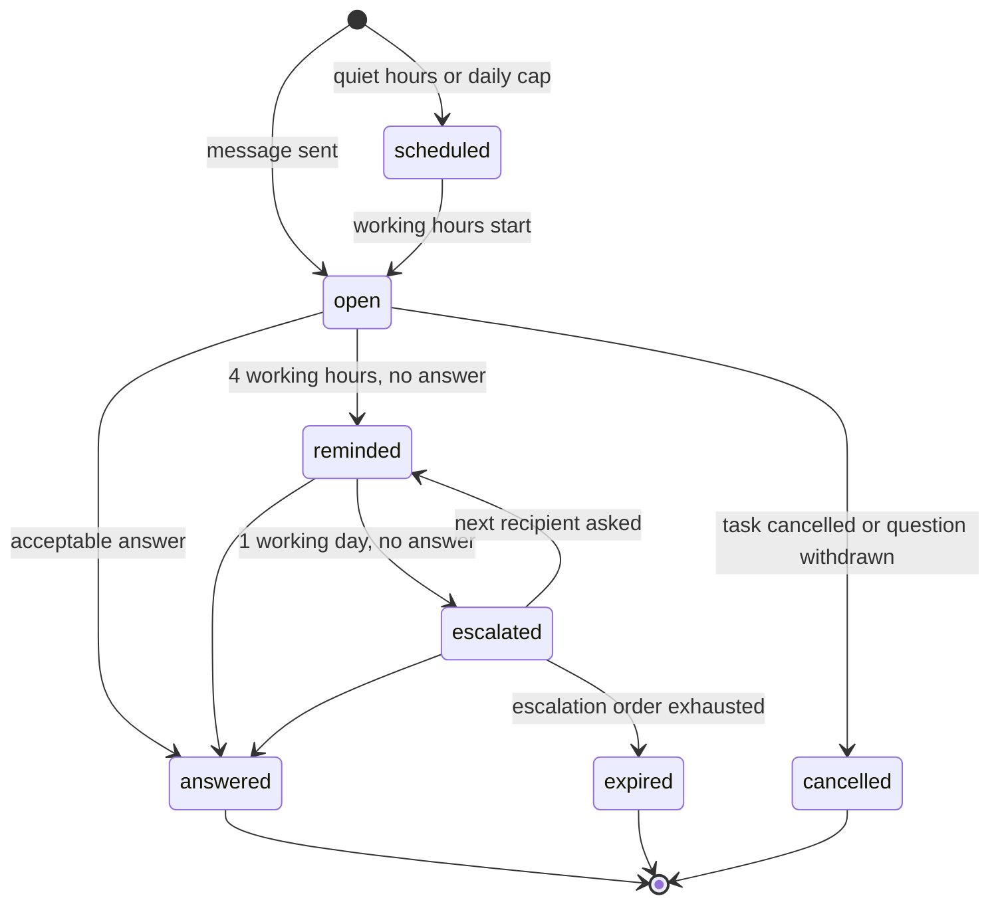

# Human Collaboration Flow

Status: **Approved** 2026-11-23 (decisions in [core-orchestrator-design.md §17](core-orchestrator-design.md)) · Part of the Core Orchestrator design set. Labels and source abbreviations are defined in [core-orchestrator-design.md §0](core-orchestrator-design.md).

**Covers:**

- Responsibility 7: how questions from Claude reach PMs and engineers through Google Chat.
- Responsibility 8: how human responses resume paused workflows.
- Reminders and escalation, approvals, and the messages the employee sends to people unprompted.

---

## 1. Existing decisions this builds on

| Decision                                                                                                                                     | Source         |
| -------------------------------------------------------------------------------------------------------------------------------------------- | -------------- |
| The agent returns a structured blocker (kind, question, evidence, suggested owner) instead of guessing                                       | TA §8          |
| Escalation order: self → knowledge → AI peer → human peer (code owner) → manager or PM                                                       | TA §8          |
| A consultation (get an answer) is separate from a delegation (get work done). Consultations are Phase 3; delegation and AI-to-AI are Phase 4 | REF §C         |
| ConsultationWorkflow is a child of the task. `consultations` rows live in Work; messages are delivered by Conversations                      | REF §C         |
| Every question is a `pending_questions` row. A reply in the thread, a quote of the question, or a DM from the asked person resolves it       | REF §B         |
| Timers: reminder after 4 working hours, the next person after 1 working day, then hand back                                                  | REF §C         |
| Contact policy: allowed roles, quiet hours, at most 3 open questions per person per day, threads preferred over DMs                          | REF §C         |
| The audience rule (no private content to people outside the source) and secret scanning apply to questions                                   | REF §C, TA §14 |
| Asking for clarification waits without consuming compute                                                                                     | PRD FR-COL-1   |
| "Asks one batch of specific questions in the thread and waits"                                                                               | PRD Journey B  |
| Approvals: an `approvals` row, a Chat card, an `approvalDecided` signal; expiry counts as rejection                                          | TA §8, WD 14   |

---

## 2. One mechanism for every question [Approved D-4, Resolves core C-4]

Today the documents describe three overlapping paths:

- Readiness clarification: TaskWorkflow waits for `answerReceived` (TA §6, §4).
- Mid-build blocker: TaskWorkflow resumes on `clarification_answered` (WD 11).
- Consultation: a child ConsultationWorkflow (REF §C).

**Proposal: every question is a consultation.** A `consultations.kind` column distinguishes the two cases:

| kind            | Asked person                                        | Typical content                                                              |
| --------------- | --------------------------------------------------- | ---------------------------------------------------------------------------- |
| `clarification` | The requester (or PM) about the task's requirements | "Should 'last login' be relative or absolute?"                               |
| `consultation`  | Anyone else with the knowledge or authority         | "Which endpoint returns the avatar URL, v1 or v2?" to the backend repo owner |

**Why one mechanism:**

- The same timers, contact policy, audience rule, answer routing and metrics (REF §G "clarification frequency") apply to both.
- There is one way for an answer to reach a task: a `pending_questions` row → `answerReceived` on `consult-{id}` → child completion. No signal can arrive at two places.
- Approvals stay separate. They are authorizations, not information, and already have their own flow (§9).

---

## 3. How a question is born

### 3.1 Three origins

| Origin                  | When                                           | Mechanism                                                                                          | Sandbox running? |
| ----------------------- | ---------------------------------------------- | -------------------------------------------------------------------------------------------------- | ---------------- |
| **Readiness**           | Before planning                                | The readiness model call returns `missingInformation[]`                                            | No               |
| **Mid-run tool call**   | During plan, build or fix                      | The agent calls the platform tool `ask_question` (core §12.2) → a `toolCall` Update on `exec-{id}` | Yes              |
| **End-of-run blockers** | When an execution ends with `status = blocked` | `result.questions[]`                                                                               | Ending           |

### 3.2 Blocking and non-blocking questions [Proposed]

Each question carries `blocking: bool` and `meanwhile` (what the agent can do without the answer).

| Type             | Agent behaviour                                                                                                  | Orchestrator behaviour                                                                                                                                                                           |
| ---------------- | ---------------------------------------------------------------------------------------------------------------- | ------------------------------------------------------------------------------------------------------------------------------------------------------------------------------------------------ |
| **Non-blocking** | Continues with the `meanwhile` work, isolating the uncertain choice (for example, behind one formatter function) | Starts the consultation. The execution keeps running. If the answer arrives while it runs, it is delivered with `Send` (session doc §5); otherwise it goes into the next execution's instruction |
| **Blocking**     | Finishes the current step, then the runtime checkpoints and ends with `status = blocked`                         | Starts the consultation(s). Task → `clarifying`. **The sandbox is destroyed and the session goes idle.** No compute while waiting                                                                |

**What happens to compute (core §19.4):** checkpoint the work → terminate the sandbox → release the branch lease and the execution slot (the next queued task is signalled). Resume uses a new sandbox restored from that checkpoint.

**Why end the execution for blocking questions instead of keeping the sandbox up:** human answers take minutes to days. A waiting sandbox costs money and holds an execution slot that another task could use. Checkpoint and resume are already required for crash recovery, so a planned stop reuses the same path.

**Optional warm wait** [Decision needed]: keep the sandbox for up to 5 minutes after a blocking question in working hours, when the asked person was active in the thread in the last 10 minutes. It saves a restore when answers are quick. Off by default until Phase 3 data shows how often it helps.

### 3.3 Question quality gate [Proposed]

Before any message goes out, one activity checks each question in turn.

1. **Already answered?** Search the bundle, the task's earlier consultations and the L2 and L4 memory for an answer. If one is found with high confidence, return it to the agent immediately ("Answered from the PF-3101 thread: use relative time"). No human is bothered.
2. **Duplicate?** The same question to the same person in the last 7 days is reused, not re-asked.
3. **Specific?** Each question must state what is unclear, the options considered, and why it blocks. Vague questions are sent back to the agent once for rewriting.
4. **Batch.** All questions for the same recipient raised within the same execution (or within 2 minutes) go out as **one message**, as the PRD requires.

**Why:** the REF risk table lists "employees pestering people with questions" as an adoption risk. The cheapest question is the one not sent. Questions caught at step 1 are logged as "should have known" signals for the quality metrics (REF §G).

---

## 4. Choosing who to ask and where (responsibility 7)

### 4.1 Recipient resolution

**[Existing]** TA §8 order; REF §F registry. **[Proposed]** routing by question kind. Owner module: Work ([core C-10](core-orchestrator-design.md)).

| Question kind (from the agent)                                  | First choice                                                                    | If unavailable or no answer                                                 |
| --------------------------------------------------------------- | ------------------------------------------------------------------------------- | --------------------------------------------------------------------------- |
| `requirement` / `decision` (product behaviour, scope, priority) | The task's requester                                                            | The requester's manager, or the team's PM                                   |
| `information` about a code area                                 | `ownersFor(repo, path)` from `repository_owners` (CODEOWNERS or manual)         | Owning unit's lead (`repositories.owning_unit_id`) → the employee's manager |
| `information` about another system or API                       | Owners of the related repository (`repository_relations`, `consumes_api_of`)    | That repository's owning unit lead                                          |
| `design` (Figma intent, missing states)                         | The designer named in the ticket or Figma file, if a member; else the requester | The requester                                                               |
| `access` (missing grant, environment)                           | The employee's manager                                                          | Org admin                                                                   |

**Filters applied to every candidate (contact policy):**

- Must be an active org member. Never an external guest (REF §B, §C).
- Must not be another AI employee in the MVP; AI peers are Phase 4.
- Must be under the per-person cap (3 open questions per day, REF §C). Over the cap, the next candidate is chosen, or the question waits until tomorrow if it is non-blocking.
- Within quiet hours, the message is scheduled for the person's next working-hours start. A blocking question still starts the clock then, not now.
- The audience check must pass (§4.3).

### 4.2 Channel choice

| Situation                                                                                           | Channel                                          | Why                                                                                      |
| --------------------------------------------------------------------------------------------------- | ------------------------------------------------ | ---------------------------------------------------------------------------------------- |
| Recipient is a member of the task's source space, and the content passes that space's audience rule | **Reply in the source thread**, with an @mention | Visible to the team. Answers land where the context is. Matches "prefer thread" (REF §C) |
| Recipient is not in the source space (for example, a backend owner)                                 | **DM** to the recipient                          | They cannot see the thread. A DM is how a colleague would ask                            |
| The content includes information restricted to the recipient (for example, from a DM with them)     | DM                                               | Audience rule                                                                            |
| The recipient has asked for DMs only (a personal preference)                                        | DM                                               | Respect preferences [Proposed: a per-member setting]                                     |

When a DM is used, a one-line note goes in the source thread: "I've asked @priya about the avatar endpoint." The requester then knows why the task is waiting, without the details being exposed.

### 4.3 Audience and safety checks on outgoing questions

- **[Existing]** The audience rule: every snippet quoted in the question must come from a source whose audience includes all readers of the target channel (TA §14).
- **[Existing]** Secret scan of the message body (REF §C).
- **[Proposed]** Code excerpts limited to 20 lines, with links to the branch or files (the reader has access to the repo through their own permissions) rather than large pastes.

---

## 5. The message as people see it

Sent by the Chat broker **as the employee** (Option B) with side-effect key `task:{id}:consult:{consultationId}:ask`.

```text
@Priya — question about PF-3106 (profile card), from abc_frontend_ai_employee

The card needs the user's avatar. I see two endpoints:
  1. GET /v1/users/{id}/avatar (used by the old header)
  2. GET /v2/profile → avatarUrl (newer, but not used in the web app yet)

Which one should new UI use?
Meanwhile: I'm building the card against an interface, so either works.
If I don't hear back by tomorrow 11:00, I'll ask @backend-lead.
```

**Format rules [Proposed]:**

- First line: who is asking and about which task.
- Then: context, the specific question, the options, what is happening meanwhile, and what happens with no answer.
- Numbered options make short replies work ("2").
- **Interactive cards** (buttons) are used only where the identity model supports them. TA and IL record as an open Phase 0 question (S1) whether a user account can send interactive cards or only a Chat app can. Until that is confirmed, the design relies on numbered text options.

---

## 6. Routing the answer back (responsibility 8, part 1)

### 6.1 Sequence: blocking question mid-build → answer → resume

```mermaid
sequenceDiagram
  autonumber
  participant RT as runtime (Agent SDK)
  participant WEB as web: runtime tool API
  participant EW as ExecutionWorkflow
  participant TW as TaskWorkflow
  participant CW as ConsultationWorkflow consult-{id}
  participant WK as Work module
  participant CONV as Conversations
  participant BRK as Chat broker
  actor ENG as Engineer
  participant MIW as MessageIntakeWorkflow

  RT->>WEB: ask_question(blocking, text, why, suggestedOwner)
  WEB->>EW: toolCall update
  EW->>TW: signal questionRaised
  TW->>WK: quality gate, resolve recipient (contact policy)
  WK-->>TW: recipient = Priya, channel = DM
  TW->>CW: start child consult-{id}
  CW->>WK: insert consultations row (open, blocking)
  CW->>CONV: insert pending_questions row (thread or DM, asked member, expiry)
  CW->>BRK: send question (key task:{id}:consult:{cid}:ask)
  BRK-->>ENG: DM
  EW-->>WEB: update result {consultationId, mode: blocking}
  WEB-->>RT: tool result: "Question sent; stop at a safe point"
  RT->>RT: finish step, checkpoint, result status=blocked
  RT-->>EW: finished
  EW-->>TW: result blocked
  TW->>TW: state clarifying, no sandbox, session idle
  ENG->>CONV: replies "2, v2 is the future"
  CONV->>MIW: message.created
  MIW->>MIW: correlate: DM from the asked member with an open pending question
  MIW->>CW: signal answerReceived
  CW->>CW: evaluate answer (answered, partial, counter-question, redirect, declined)
  CW->>WK: consultation answered, ConsultationAnswered (outbox)
  CW->>BRK: "Thanks, Priya, using /v2/profile." (key …:ack)
  CW-->>TW: child completed {answer, answerer}
  TW->>TW: all blocking questions closed?
  TW->>TW: rebuild bundle with answer, admit(Unblock priority)
  TW->>EW: start exec (kind=build, session=resume, instruction "Answer from Priya: …")
```

### 6.2 Correlation rules

These rules come from REF §B. The details marked [Proposed] are additions in this design.

| How the human replies                                          | Routed by                                                                                                                                                                                                                |
| -------------------------------------------------------------- | ------------------------------------------------------------------------------------------------------------------------------------------------------------------------------------------------------------------------ |
| In the same thread as the question                             | Thread + open `pending_questions` row for that thread                                                                                                                                                                    |
| By quoting the question anywhere                               | Quote match                                                                                                                                                                                                              |
| By DM to the employee, when asked in a thread (or the reverse) | A DM from the **asked member** while that member has exactly one open pending question with this employee. With several open, the classifier picks one, or the employee asks which question is being answered [Proposed] |
| In the dashboard                                               | `POST /v1/orgs/{org}/consultations/{id}:answer` [Proposed]                                                                                                                                                               |
| Card button (where supported)                                  | Card action carries `consultationId`                                                                                                                                                                                     |

### 6.3 Evaluating the answer [Proposed]

`answerReceived` does not close the consultation blindly. A structured model call over the question and the reply returns one of these outcomes:

| Outcome                  | Example                              | Action                                                                                                                                                                     |
| ------------------------ | ------------------------------------ | -------------------------------------------------------------------------------------------------------------------------------------------------------------------------- |
| `answered`               | "2" / "Use v2"                       | Close as answered and complete the child                                                                                                                                   |
| `partial`                | "v2, but I'm not sure about caching" | Close with the answer, and add the open part as a non-blocking note to the agent                                                                                           |
| `counter_question`       | "Which page is this for?"            | An answer run replies from the task context (no sandbox). The consultation stays open and the timers keep running                                                          |
| `redirect`               | "Ask Ravi, he owns that now"         | Signal `redirected`: a new recipient (if allowed by the contact policy), a fresh message referencing the redirect. **Optionally**, suggest a CODEOWNERS update to an admin |
| `declined` / `dont_know` | "No idea"                            | Escalate to the next recipient in the order                                                                                                                                |
| `not_an_answer`          | Unrelated chatter                    | Leave open; remember only                                                                                                                                                  |

**Who may answer:**

- **Information questions:** any active org member in the thread may answer. The answerer is recorded.
- **Decision and requirement questions:** an answer from someone other than the asked person, the requester, or the requester's manager is accepted provisionally. The requester is asked to confirm in one line: "Mia suggested relative time; OK to go with that?".

Why: the person who owns the requirement decides it. Information, by contrast, is valid whoever provides it.

### 6.4 Edge cases

| Case                                                                       | Handling                                                                                                                                                                                                                               |
| -------------------------------------------------------------------------- | -------------------------------------------------------------------------------------------------------------------------------------------------------------------------------------------------------------------------------------- |
| Answer arrives after escalation to the next person                         | The first acceptable answer wins. Later ones are stored as additional input; if they conflict with the accepted answer, the requester is asked                                                                                         |
| Answer arrives after the consultation expired and the task was handed back | Recorded. A reply offers to resume: "Thanks — want me to pick PF-3106 back up?" A yes triggers the task `retry` Update                                                                                                                 |
| The answer message is later edited                                         | The REF §B edit flow: if already used, `requirementsChanged` with the diff to the task                                                                                                                                                 |
| The answer message is deleted                                              | The answer stays in the task record (it was acted on); the stored text is purged from memory (TA §14)                                                                                                                                  |
| Several blocking questions to different people                             | The TaskWorkflow waits for **all** of them. If some are answered and the rest have been escalated for more than 1 working day, the agent is resumed with the partial answers, provided its `meanwhile` says it can progress [Proposed] |
| A human asks the employee something while it is waiting                    | Normal intake: a status question gets an answer run; an instruction goes to the task (`instructionReceived`) and is included at resume                                                                                                 |
| The asked person is suspended or leaves the org                            | `MemberStateChanged` → the consultation escalates immediately                                                                                                                                                                          |

---

## 7. Resuming the paused workflow (responsibility 8, part 2)

### 7.1 Temporal mechanics [Proposed]

- **Waiting.** The TaskWorkflow holds a set of open blocking consultation ids. It awaits `condition(() => openBlocking.size === 0 || partialResumeAllowed())`. Each ConsultationWorkflow's completion promise removes its id. While waiting, the workflow consumes no worker resources; Temporal persists the wait.
- **Ordering.** Signals to the TaskWorkflow (for example, an instruction arriving while waiting) queue in arrival order. They are folded into the resume instruction, so nothing is lost and nothing interrupts the wait.
- **Continue-as-new.** Open consultation ids are part of the carried-over state ([core §10.4](core-orchestrator-design.md)). Child workflows survive the parent's continue-as-new because they are addressed by id. The new run re-attaches with `getExternalWorkflowHandle(consult-{id})` and awaits its result through a `consultationClosed` signal that the child sends to its parent on completion. Why both: child completion is the primary path; the signal makes it robust across parent runs.

### 7.2 What happens at resume

1. **Record.**
   - The answer is written to `consultations.answer_message_id` and the status.
   - A new bundle version adds `answers.md`.
   - If the answer is reusable (a convention, an API fact), it becomes a **candidate** team memory item (REF §C, "if reusable, in team memory"). Team-preference items need the manager's approval (task-lifecycle §9).
2. **Admit.** An execution at the **Unblock** priority class (task-lifecycle §5.2).
3. **Decide the session.** Usually a resume (session doc §3).
4. **Instruct.** The execution's instruction carries the questions and answers verbatim, with the answerers' names and roles. Example: "Priya (backend owner) answered: use GET /v2/profile."
5. **Tell the requester.** A thread note only if the wait was longer than 1 working hour: "Got the answer from Priya; continuing."

### 7.3 Non-blocking answers

| Execution state when the answer arrives      | Delivery                                                                    |
| -------------------------------------------- | --------------------------------------------------------------------------- |
| Running                                      | `deliverInstruction` → `Send` at the next safe point (session doc §5)       |
| Not running, task in `in_review` or `queued` | Added to the next execution's instruction                                   |
| Task done                                    | Stored as feedback; if it changes the outcome, a follow-up task is proposed |

---

## 8. Reminders, escalation and expiry

### 8.1 ConsultationWorkflow states



### 8.2 Behaviour

| Event                         | Message                                                                                                                                                                                                                                                                                                                   | Label                                           |
| ----------------------------- | ------------------------------------------------------------------------------------------------------------------------------------------------------------------------------------------------------------------------------------------------------------------------------------------------------------------------- | ----------------------------------------------- |
| Reminder                      | A reply to the original message: "Gentle nudge on this — it's blocking PF-3106."                                                                                                                                                                                                                                          | [Existing] timing REF §C; wording [Proposed]    |
| Escalation                    | A new message to the next recipient. It quotes the original question and names who was asked first. The first person gets "I've also asked @lead."                                                                                                                                                                        | [Existing] REF §C                               |
| Expiry, blocking question     | The TaskWorkflow hands back: a thread summary of the open questions, what was tried, and the branch state. **Or**, if the question was marked `safeDefault` and team policy allows, it proceeds with the default and says so ("No answer, so I used relative time; easy to change in `formatLastSeen`") [Decision needed] | [Existing] hand back; default option [Proposed] |
| Expiry, non-blocking question | The agent's interim choice stands. A note goes in the PR description for reviewers                                                                                                                                                                                                                                        | [Proposed]                                      |
| Withdrawal                    | If the agent no longer needs the answer (it found it), the consultation is cancelled with "Never mind, found it: …". People appreciate not being left hanging                                                                                                                                                             | [Proposed]                                      |

All durations count **working hours of the recipient** (calendar where available, else the org default) and respect quiet hours. They are configurable per org unit in the contact policy (REF §C).

---

## 9. Approvals (authorization, not information)

**[Existing]** TA §8 and WD 14: policy `require_approval(approvers, quorum, expiry)` → an `approvals` row → a Chat card or dashboard inbox → an `approvalDecided` signal → expiry counts as rejection. **[Proposed]** clarifications:

| Item                           | Design                                                                                                                                                                                                                                       |
| ------------------------------ | -------------------------------------------------------------------------------------------------------------------------------------------------------------------------------------------------------------------------------------------- |
| Triggers in the task lifecycle | Plan approval (when policy requires it); sensitive actions from the default policy pack (force-push, protected paths, external messages); missing grants found at intake                                                                     |
| Approver resolution            | From `approval_rules`. Default for plan approval: the requester's manager [core C-17]                                                                                                                                                        |
| Text approvals                 | If cards are unavailable (Option B uncertainty, §5), a reply of "approve" or "reject" in the approval's thread is accepted **only from a listed approver**. It is classified as type `approval` and still recorded in `approvals.decided_by` |
| While waiting                  | Task state `awaiting_approval`; no sandbox; reminder at half the expiry                                                                                                                                                                      |
| Decision with conditions       | For example "only the feature branch". Stored and passed into the next execution's `allowedTools` and conditions (SS example)                                                                                                                |

---

## 10. Messages the employee sends without being asked [Proposed]

The PRD (FR-COM-3) lists acknowledgement, questions, progress, completion and escalation. To keep the employee useful without being noisy:

| Moment                                                  | Where                                                           | Always?                                                                 |
| ------------------------------------------------------- | --------------------------------------------------------------- | ----------------------------------------------------------------------- |
| Acknowledgement                                         | Source thread                                                   | Yes, within 10 s                                                        |
| Plan summary (3–6 bullets, risks, ETA in working hours) | Source thread                                                   | Yes, unless the plan is trivial (≤ 2 steps)                             |
| Questions                                               | Thread or DM (§4.2)                                             | When needed                                                             |
| Queued or blocked notices                               | Source thread                                                   | When the wait exceeds the thresholds in task-lifecycle §6.2             |
| PR opened, with summary and evidence                    | Source thread + Jira                                            | Yes                                                                     |
| Review round addressed                                  | PR comments; thread only if the requester asked to follow along | PR yes, thread optional                                                 |
| Completion                                              | Source thread + Jira                                            | Yes                                                                     |
| Hand-back with analysis                                 | Source thread, @mention of the requester                        | Yes                                                                     |
| Progress update                                         | Source thread                                                   | At most once per 4 working hours per task, only for long builds (> 1 h) |

All of these go through the Chat broker with deterministic side-effect keys, so a replay can never duplicate them (TA §4).

---

## 11. Data entities

**[Existing]** tables: `consultations` (Work; REF §C), `pending_questions` (Conversations; REF §B), `approvals` (Work), `messages`, `message_task_links`, `side_effects`.

**[Proposed]** columns:

| Table                    | Column                                                                                   | Purpose                                           |
| ------------------------ | ---------------------------------------------------------------------------------------- | ------------------------------------------------- |
| consultations            | `kind` (clarification, consultation)                                                     | §2                                                |
| consultations            | `question_kind` (requirement, decision, information, design, access)                     | Recipient routing (§4.1)                          |
| consultations            | `blocking` bool, `meanwhile` text, `safe_default` text null                              | §3.2, §8.2                                        |
| consultations            | `execution_id`, `batch_id`                                                               | Origin, and batching of one message per recipient |
| consultations            | `escalation_level` int, `previous_consultation_id`                                       | Escalation chain                                  |
| consultations            | `answer_outcome` (answered, partial, redirect, declined, expired)                        | §6.3; quality metrics                             |
| consultations            | `answered_by_member_id`                                                                  | Who actually answered                             |
| pending_questions        | `consultation_id`                                                                        | Links the routing record to the business record   |
| members                  | `contact_preferences` jsonb (DM preference, working hours override)                      | §4.2                                              |
| organizations, org_units | `settings` jsonb with a `contact_policy` key (versioned, validated, audited; core §18.2) | REF §C contact policy [Approved D-13]             |

## 12. Events

**[Existing]** ConsultationRequested, ConsultationAnswered, ConsultationEscalated, ConsultationExpired, ClarificationAnswerRouted, ApprovalRequested, ApprovalDecided, MessageSent.

**[Proposed]** a `kind` field on the consultation events, so that ClarificationRequested and ClarificationAnswered (TA §4) become ConsultationRequested and ConsultationAnswered with `kind = clarification`. This avoids two event families for one mechanism [core C-5]. Also proposed: ConsultationWithdrawn.

## 13. Failure scenarios

| Failure                                                                | Recovery                                                                                                                                               | Label                                   |
| ---------------------------------------------------------------------- | ------------------------------------------------------------------------------------------------------------------------------------------------------ | --------------------------------------- |
| Question message fails to send                                         | Broker retry with the same side-effect key. If undelivered after 24 h, the dashboard shows it and the consultation clock does not start until delivery | [Existing] retry; clock rule [Proposed] |
| Answer event missed (Chat delivery gap)                                | Thread reconcile poll of threads with open pending questions, every 10 minutes                                                                         | [Existing] REF §C; cadence [Proposed]   |
| Wrong correlation (the answer attached to the wrong question)          | The relink tool (REF §B); a relink re-signals the correct consultation and reopens the wrong one                                                       | [Existing]                              |
| Answer evaluation model unavailable                                    | Treat as `answered`, and include the raw text for the agent to judge                                                                                   | [Proposed]                              |
| The recipient's DM is not possible (identity Option A, or DMs blocked) | Fall back to an @mention in the source thread, or in the team space if the recipient is not in the source space                                        | [Proposed]                              |
| Worker restarts during a wait                                          | Nothing happens; the timers live in Temporal                                                                                                           | [Existing]                              |
| A contact policy change during a wait                                  | Applied at the next timer event (reminder or escalation)                                                                                               | [Proposed]                              |

## 14. Phase notes

- **Phase 3 (MVP):** everything above, with human recipients only.
- **Phase 4:** AI peers as recipients. The same consultation mechanism; the answer comes from a lightweight answer run of the target employee (TA §8). Delegation (a new task with a dependency) uses `task_dependencies` and `dependencyResolved`, not consultations.

## 15. Decisions

**Approved** (core §17):

- D-4: every human question uses ConsultationWorkflow; approvals keep their own flow.
- D-11: correlation threshold 0.75.
- D-12: contact policy defaults.
- D-13: contact policy stored as versioned JSONB in `organizations.settings` and `org_units.settings`, with schema validation, revisions and audit (core §18.2).

**Still open:** U-2 cards for user accounts; U-9 warm wait; U-10 safe default on expiry; U-11 who may answer decision questions; U-12 DM preference; U-13 progress update thresholds ([core §20](core-orchestrator-design.md)).
