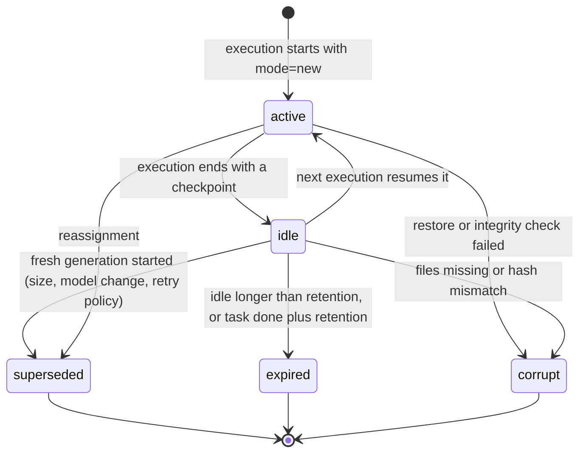
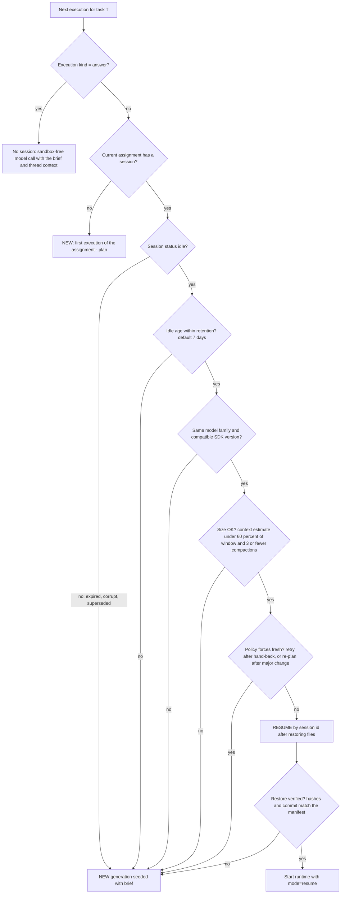
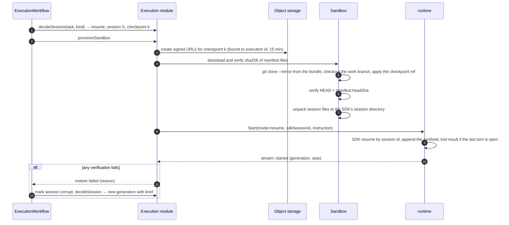

# Session Management

Status: **Approved** 2026-11-23 (decisions in [core-orchestrator-design.md §17](core-orchestrator-design.md)) · Part of the Core Orchestrator design set. Labels and source abbreviations are defined in [core-orchestrator-design.md §0](core-orchestrator-design.md).

**Covers:**

- Responsibility 5: when to start a new Claude session and when to resume one.
- How sessions survive sandboxes, crashes, interruptions and long human waits.
- How instructions reach a running session.

---

## 1. Concepts

| Term              | Meaning                                                                                                                                                                               | Label                                                         |
| ----------------- | ------------------------------------------------------------------------------------------------------------------------------------------------------------------------------------- | ------------------------------------------------------------- |
| **Agent session** | The Claude Agent SDK's conversation state for one task: the transcript files and the session id. Stored as files in object storage between executions                                 | [Existing] TA §7                                              |
| **Generation**    | A session's lineage number within a task assignment. Starting a _fresh_ session for the same assignment creates generation n+1, with `parent_session_id` pointing to the previous one | [Proposed]                                                    |
| **Task brief**    | `brief.md`: a one-to-two page handoff note that lets a fresh session continue the task. It is rewritten at every checkpoint                                                           | [Proposed]; REF §A mentions "seeded with the task summary"    |
| **Checkpoint**    | An atomic set: a git bundle of the workspace + the session files + the brief + a manifest, all taken at the same moment                                                               | [Existing] REF §A; atomicity and brief [Proposed]             |
| **Assignment**    | The period during which one employee owns the task. Reassignment starts a new assignment                                                                                              | [Existing] PRD §3; stored as `tasks.assignment_no` [Proposed] |

**Existing rules (TA §7, REF §A), kept unchanged:**

1. New session per task assignment, seeded with the context bundle and plan.
2. Continue the session for later attempts on the same task (review fixes, retries, answers) while within retention, by restoring the session files into the new sandbox and resuming by session id.
3. Start fresh with a written summary when the session has expired, grown too large, or the model or provider changed.
4. Never share a session across tasks or employees. Long-term knowledge lives in employee memory (L4), not in sessions.

This document turns those rules into precise conditions, a state machine, contracts and failure handling.

---

## 2. Session state machine [Proposed]



- **active:** attached to exactly one running execution. Guarded by the task's single-writer rule (one execution per task, REF §A). Two executions can therefore never write to the same session.
- **idle:** files at rest in object storage. **A task waiting for a human, a review or QA holds an idle session and no sandbox.** This is how "wait without consuming compute" (FR-COL-1) is met.
- **superseded / expired / corrupt:** never resumed again. Their files are kept for audit until the retention period ends (TA §13 transcripts), then deleted.

---

## 3. Deciding: new or resume (responsibility 5)

### 3.1 Decision procedure [Proposed]

The decision runs as one activity, `decideSession(taskId, executionKind)`, before every execution. The result is recorded in `executions.session_mode` (`new` or `resume`), with a reason code. Why record it: every "why did the agent forget X?" question can then be answered from data.



### 3.2 The conditions and why each exists

All defaults below are approved as **configurable defaults** (org or team scope, core §18.1). The task and assignment rules are fixed invariants (core §19.1).

| Condition                        | Default                                                                         | Why                                                                                                                                                                                                                                                                  | Label                                               |
| -------------------------------- | ------------------------------------------------------------------------------- | -------------------------------------------------------------------------------------------------------------------------------------------------------------------------------------------------------------------------------------------------------------------- | --------------------------------------------------- |
| Same task, same assignment       | Required                                                                        | Sessions hold task-specific reasoning and, possibly, content from that task's audience. Sharing across tasks would leak context and break isolation (REF §A, TA §11). A new assignee is a different "person" and must not inherit another employee's reasoning trail | [Existing] rule; assignment check [Proposed]        |
| First execution of an assignment | New                                                                             | The plan run explores the repo with a clean context; the bundle and plan seed it                                                                                                                                                                                     | [Existing] TA §7                                    |
| Status `idle`                    | Required                                                                        | Only a cleanly checkpointed session is safe to resume                                                                                                                                                                                                                | [Proposed]                                          |
| Idle age ≤ retention             | 7 days [Decision D-8]                                                           | After a long gap, the transcript describes a codebase and conversation that have moved on, and the brief plus a fresh look is more reliable. Also bounds storage                                                                                                     | [Existing] "within retention"; value [Proposed]     |
| Model family and SDK version     | Same family; SDK major version equal                                            | Transcript formats and tool schemas can change between versions, and a different model may misread another's reasoning trail                                                                                                                                         | [Existing] TA §7; SDK check [Proposed]              |
| Size                             | Context estimate < 60 % of the model's window **and** ≤ 3 automatic compactions | Each compaction loses detail; beyond a few, a purpose-written brief beats a summary of a summary. The 60 % leaves room for the fix instructions and the tool outputs                                                                                                 | [Existing] "grown too large"; thresholds [Proposed] |
| Retry after hand-back            | Fresh                                                                           | A hand-back means the previous line of reasoning failed. A fresh session with the hand-back analysis in the brief avoids repeating it                                                                                                                                | [Proposed]                                          |
| Major requirement change         | Fresh _or_ resume, depending on impact (§5)                                     | A small change fits the current reasoning. A major one may be better served by a clean re-plan; resume is the default unless the impact is `major` and the plan is invalidated                                                                                       | [Proposed]                                          |
| Restore verification             | Must pass                                                                       | A session whose git state does not match its manifest would reason about code that is not there                                                                                                                                                                      | [Proposed]; REF risks                               |

### 3.3 Per execution kind

| Kind                                         | Session                                                                                                          | Notes                                                                                                                                                                            |
| -------------------------------------------- | ---------------------------------------------------------------------------------------------------------------- | -------------------------------------------------------------------------------------------------------------------------------------------------------------------------------- |
| `plan`                                       | New at the start of an assignment. On re-plan (major change): resume, or fresh if the decision procedure says so | Read-only sandbox                                                                                                                                                                |
| `build`                                      | Resume (usually the plan's session)                                                                              | WD 7: "build attempt (resume session)"                                                                                                                                           |
| `fix` (review, CI, QA, conflict)             | Resume                                                                                                           | The reviewer's comments land in the same reasoning context that wrote the code                                                                                                   |
| `review_reply` (read-only answers on the PR) | Resume, **read-only tool set**                                                                                   | One writer per task still applies; it is queued like any execution                                                                                                               |
| `answer` (chat status or general question)   | **No session**                                                                                                   | Sandbox-free model call over the brief, the task projection and the thread. It never touches the task session, so a quick chat question can be answered while a build is running |
| Continuation after `limit_reached`           | Resume                                                                                                           | If the size condition fails, a fresh generation with the brief                                                                                                                   |

### 3.4 Fresh session seeded with the brief

When the decision is `new` for an existing assignment, `StartSpec.session` carries `{mode: "new", seedBriefUri}`. The runtime:

1. Restores the workspace from the latest checkpoint's git bundle. The code is preserved even though the conversation is not.
2. Starts a new SDK session. The first user turn includes `brief.md`, plus an instruction to verify the brief against the workspace (`git log`, `git diff base..HEAD`) before continuing.
3. Writes `parent_session_id` and `generation = n+1` to `agent_sessions`.

**What the brief contains** (the runtime writes it at each checkpoint):

| Section                  | Written by                               | Content                                                                                          |
| ------------------------ | ---------------------------------------- | ------------------------------------------------------------------------------------------------ |
| Task                     | Runtime code                             | Title, Jira key, completion criteria, assignment number, bundle version                          |
| Plan and progress        | Runtime code, from `plan.json` and state | Steps with done, current or pending                                                              |
| Decisions and answers    | Agent (handoff note)                     | Choices made and why; answers from consultations, with who answered                              |
| Workspace                | Runtime code                             | Base sha, head sha, a `git diff --stat` summary, uncommitted files (normally none at checkpoint) |
| Review history           | Runtime code                             | Per round: the comments and how each was resolved                                                |
| Open questions and risks | Agent                                    | Anything unresolved                                                                              |
| Pitfalls                 | Agent                                    | "Tests in `e2e/` need `PLAYWRIGHT_BASE_URL`", and similar                                        |

**Why the agent writes part of the brief:** only the agent knows _why_ it made its choices. A short "write your handoff note" prompt at each checkpoint costs a few hundred tokens and makes every crash, expiry and reassignment much cheaper to recover from. The deterministic parts are written by code, so they are always correct.

---

## 4. Checkpoints [Existing cadence, Proposed content and atomicity]

**Cadence** (REF §A): at each plan step, and at least every 10 minutes. Also forced on interrupt, on `limit_reached`, and at the end of every execution. **[Resolves core C-7]:** this replaces the "every N turns" cadence in SS and the "snapshot only if follow-up expected" rule in TA §7.

**Atomicity.** The runtime pauses between tool calls (never mid-tool). It then takes everything listed below at the same instant, so the conversation and the code always agree.

- `git bundle create` of the work branch, plus a stash of any uncommitted changes as a temporary commit on a checkpoint ref.
- A copy of the SDK session files.
- `brief.md`.
- `manifest.json`, recording:
  - checkpoint sequence number, execution id, session id and generation
  - SDK version and model
  - head sha and plan step
  - sha256 of every file

**Layout** (object storage, encrypted with the org key; TA §11):

```text
obj://{org}/tasks/{task}/checkpoints/{seq}/
  repo-{repoId}.bundle
  session.tar.zst
  brief.md
  manifest.json
```

The runtime then updates `task_workspaces.snapshot_uri`, `agent_sessions.session_uri`, `agent_sessions.last_checkpoint_at` and `brief_uri`. The checkpoint pointer is written last, so a half-written checkpoint is never referenced.

**Retention:** the last 3 checkpoints per task while it is open; the final one for 14 days after done [Decision needed]. Work in progress is never pushed to the remote (REF §A).

---

## 5. Instructions to a running session (mid-run changes) [Proposed, Resolves core C-23]

**[Existing]** REF §A: new messages during a run are queued as signals and applied at the next safe point, "or passed into the running session as a mid-run instruction when the change is small". REF §B: on a changed requirement, "the employee confirms what it will change".

**Impact assessment.** When the TaskWorkflow receives `instructionReceived` or `requirementsChanged` while an execution is running, it runs a quick structured model call. Inputs: the instruction, the current plan and progress, and the completion criteria. Output: `impact ∈ {none, minor, major}`, with a one-line restatement.

| Impact  | Examples                                                                                                                      | Action                                                                                                                                                                                                                |
| ------- | ----------------------------------------------------------------------------------------------------------------------------- | --------------------------------------------------------------------------------------------------------------------------------------------------------------------------------------------------------------------- |
| `none`  | "Thanks!", "FYI the designer is out today"                                                                                    | Remember only. If it was a question, an answer run handles it                                                                                                                                                         |
| `minor` | "Use the blue variant", "Name the prop `lastSeenAt`", an answer to a non-blocking question, a design link                     | `deliverInstruction` → supervisor `Send(text, source)`: the text arrives as a user turn at the next safe point between tool calls. A thread reply confirms: "Got it, switching to the blue variant"                   |
| `major` | New or removed acceptance criteria; a different target branch or repo; "also add an API endpoint"; "stop, the design changed" | `interrupt(newInstruction)` → checkpoint → bundle rebuilt with the change → **re-plan** execution (resume, or fresh per §3) → the thread states what will change and asks for confirmation if the scope grew (REF §B) |

**Why a model call decides:** keyword rules cannot tell "use blue" (minor) from "use the new layout" (major). A wrong `minor` costs one wasted step, because the agent re-plans itself if the instruction conflicts. A wrong `major` costs a re-plan. Both are recoverable.

**Safety rules for `Send`:**

- The text is wrapped as untrusted data with the sender's name and role (TA §11).
- It cannot widen tools or grants; those are fixed in `StartSpec`.
- Only instructions from members authorized for the task (requester, owner's manager, actionable reviewers) are delivered. Others are answered in the thread but not injected.

---

## 6. Data model [Proposed column additions; Existing table]

`agent_sessions` (Execution module; TA §9: id, org_id, task_id, member_id, runtime, model, session_uri, status, last_used_at):

| Column                                      | Type                                             | Purpose                                                    |
| ------------------------------------------- | ------------------------------------------------ | ---------------------------------------------------------- |
| `assignment_no`                             | int                                              | Ties the session to an assignment (core C-13)              |
| `generation`                                | int                                              | Lineage within the assignment                              |
| `parent_session_id`                         | uuid null                                        | The superseded predecessor                                 |
| `sdk_session_id`                            | text                                             | The SDK's own id for resume                                |
| `sdk_version`                               | text                                             | Compatibility check                                        |
| `status`                                    | enum: active, idle, expired, superseded, corrupt | §2                                                         |
| `brief_uri`                                 | text                                             | Latest brief                                               |
| `last_checkpoint_seq`, `last_checkpoint_at` | int, timestamptz                                 | Restore target                                             |
| `token_estimate`, `compactions`             | int, int                                         | Size conditions                                            |
| `superseded_reason`                         | text                                             | Audit ("size", "model_changed", "retry_after_handback", …) |

`executions` gains `session_mode` (new or resume), `session_id`, `session_reason`.

**Unique constraint:** at most one session with status `active` or `idle` per (task_id, assignment_no). Why: it enforces "never share" and "one current session" in the database, not only in code.

---

## 7. Failure and interruption cases

| Case                                            | What exists                             | Recovery                                                                                                                                                                                                                                                                                                                                  | Label                                                                       |
| ----------------------------------------------- | --------------------------------------- | ----------------------------------------------------------------------------------------------------------------------------------------------------------------------------------------------------------------------------------------------------------------------------------------------------------------------------------------- | --------------------------------------------------------------------------- |
| Crash before the first checkpoint of a plan run | Nothing to resume                       | New session (plan restarts)                                                                                                                                                                                                                                                                                                               | [Proposed]                                                                  |
| Crash mid-build (VM or runtime)                 | Checkpoint k                            | Restore checkpoint k into a new sandbox; resume the session. The last transcript entry may be an unanswered tool call, so the runtime appends a synthetic tool result: "Execution was interrupted and the workspace restored to checkpoint k (step 3, sha a1b2). Re-check the state before continuing." Work since checkpoint k is redone | [Existing] REF §A; synthetic result [Proposed] [Assumption: validate in S4] |
| Worker crash                                    | The sandbox is still running            | The supervisor reattaches (core §2); **the session is untouched**                                                                                                                                                                                                                                                                         | [Proposed]                                                                  |
| Orderly interrupt                               | Final checkpoint                        | Session `idle`; the next execution resumes with the new instruction                                                                                                                                                                                                                                                                       | [Proposed]                                                                  |
| Interrupt grace exceeded                        | Last periodic checkpoint (≤ 10 min old) | As "crash mid-build"                                                                                                                                                                                                                                                                                                                      | [Proposed]                                                                  |
| Session files missing or hash mismatch          | The git bundle may be fine              | Mark `corrupt`; fresh generation from the brief, with the workspace from the git bundle                                                                                                                                                                                                                                                   | [Proposed]                                                                  |
| Git bundle corrupt                              | The session may be fine                 | Previous checkpoint → last pushed commit → base. **Resume is not allowed** if the code state goes back further than the session remembers; start fresh with the brief and state what was lost                                                                                                                                             | [Existing] REF risk mitigation; rule [Proposed]                             |
| SDK upgrade between executions                  | Old-format session                      | Fresh generation (version check)                                                                                                                                                                                                                                                                                                          | [Proposed]                                                                  |
| Model change by policy or fallback (TA §12)     | —                                       | Fresh generation                                                                                                                                                                                                                                                                                                                          | [Existing] TA §7                                                            |
| Context overflow mid-run                        | The SDK compacts automatically          | Counted in `compactions`. Over the limit: checkpoint, then a planned fresh generation at the next execution boundary (never mid-run)                                                                                                                                                                                                      | [Proposed]                                                                  |
| Task reassigned                                 | —                                       | Session `superseded`; the new owner starts fresh with the brief (task-lifecycle §6.5)                                                                                                                                                                                                                                                     | [Proposed]                                                                  |
| Employee terminated                             | —                                       | All its sessions expire; files archived per retention (REF §E)                                                                                                                                                                                                                                                                            | [Existing]                                                                  |

---

## 8. Restore sequence



---

## 9. Security

| Concern                                                                 | Control                                                                                                                                           | Label                                       |
| ----------------------------------------------------------------------- | ------------------------------------------------------------------------------------------------------------------------------------------------- | ------------------------------------------- |
| Session files contain code, conversation and possibly sensitive context | Encrypted with the org key; readable only by the Execution module; restorable only through signed URLs bound to the execution id of the same task | [Existing] REF §A                           |
| Secrets in transcripts                                                  | Redacted at write (TA §13); secret scan before upload                                                                                             | [Existing]                                  |
| Cross-audience leakage                                                  | Sessions never cross tasks. Answer runs use the brief, filtered by the audience rule for the asking thread (TA §14), never the raw session        | [Existing] rule; answer-run rule [Proposed] |
| Prompt injection via mid-run instructions                               | Wrapped as data; sender-authorized; cannot change tools or grants                                                                                 | [Existing] TA §11; delivery rule [Proposed] |
| Retention and deletion                                                  | Transcripts follow org retention; admin deletion purges checkpoints                                                                               | [Existing] TA §14                           |

---

## 10. Phase 0 validation (extends spike S4)

S4 currently: "Resumed run continues correctly after a forced VM kill". Proposed additional pass conditions:

1. Resume works after the session files are moved to a sandbox on a **different host** (TA §7 assumption).
2. Resume works when the last transcript entry is an unanswered tool call, using a synthetic result.
3. `Send` of a mid-run instruction is accepted between tool calls without corrupting the turn.
4. A fresh session seeded only with `brief.md` and the restored workspace completes the remaining plan steps of a recorded task with no more than one extra clarification.
5. Measure session file size and restore time at 50, 150 and 300 turns, to set the size thresholds in §3.2.

## 11. Decisions

**Approved** (core §17 D-8): the resume policy in §3.2 is adopted as **configurable defaults**:

- `session.max_idle_days` = 7
- `session.max_context_ratio` = 0.6
- `session.max_compactions` = 3
- `session.fresh_after_handback` = true

They are set per org or team (core §18.1). The invariant "one session per task and assignment, never shared" is not configurable.

**Still open:** U-7 checkpoint retention after done; U-8 the cadence of the agent-written brief ([core §20](core-orchestrator-design.md)).
