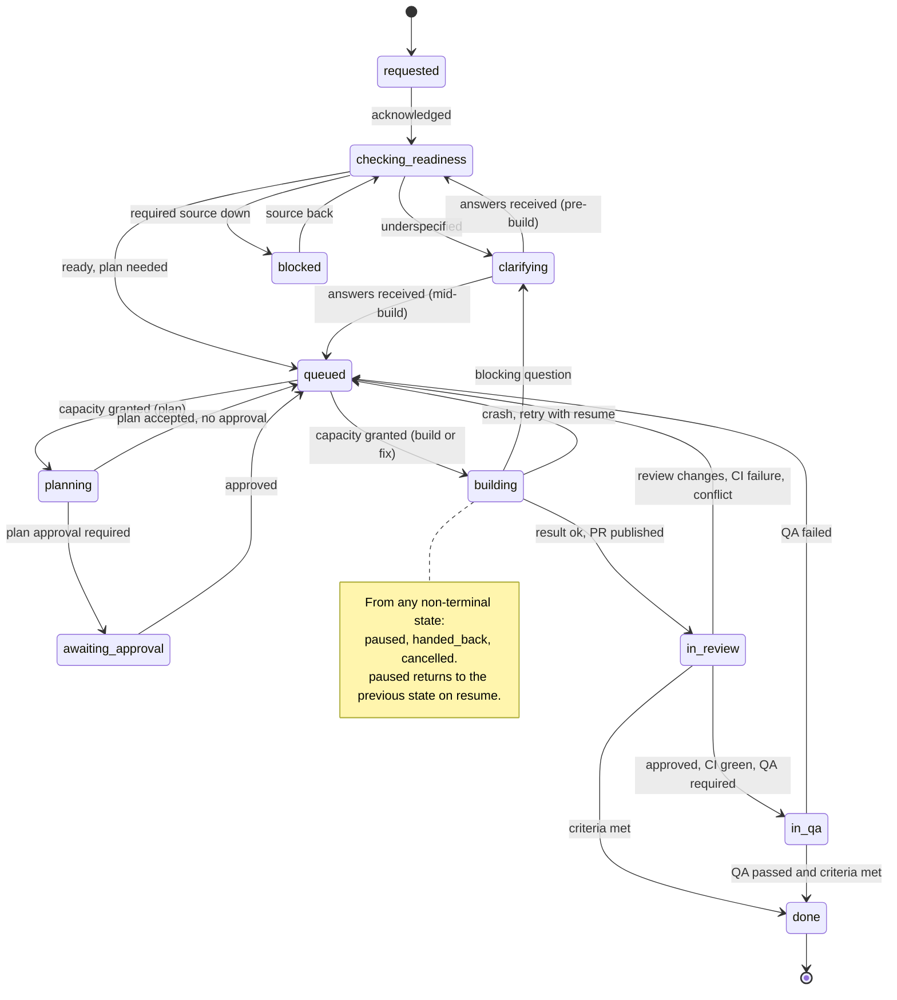
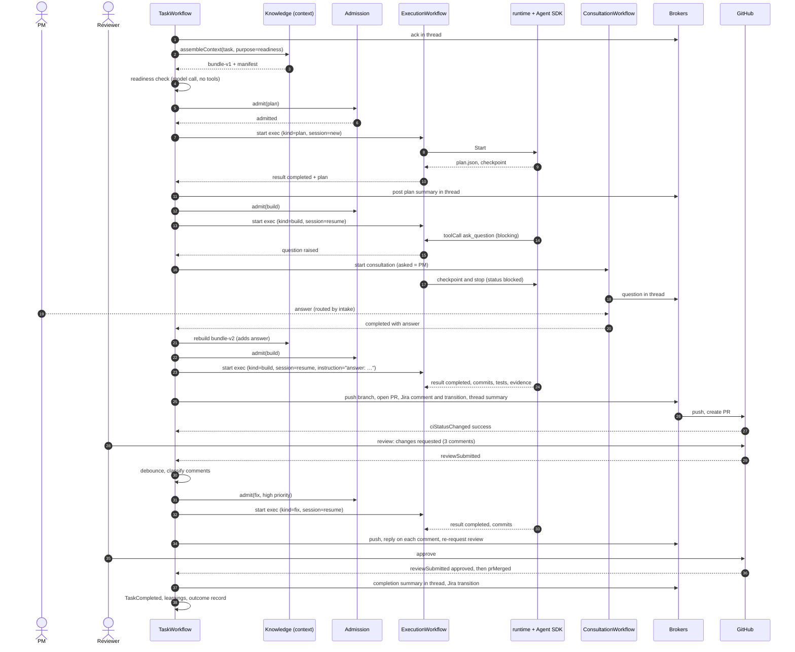
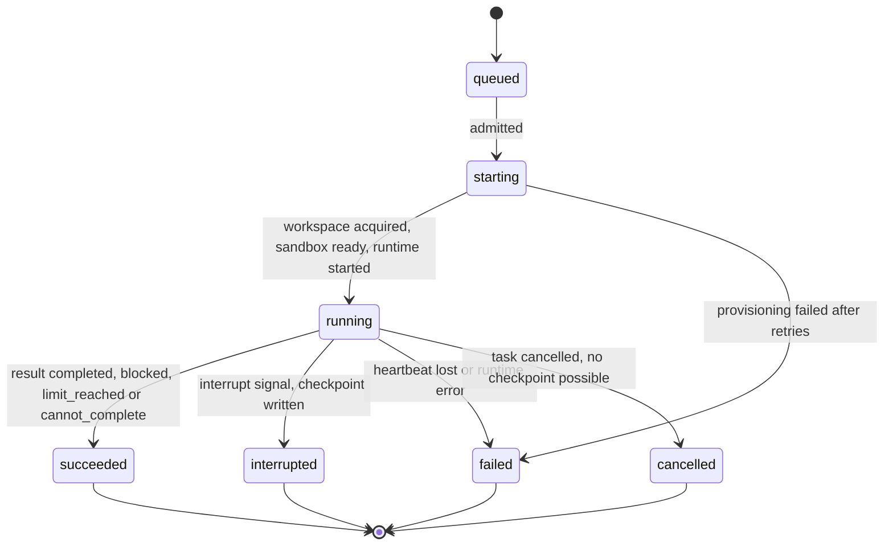
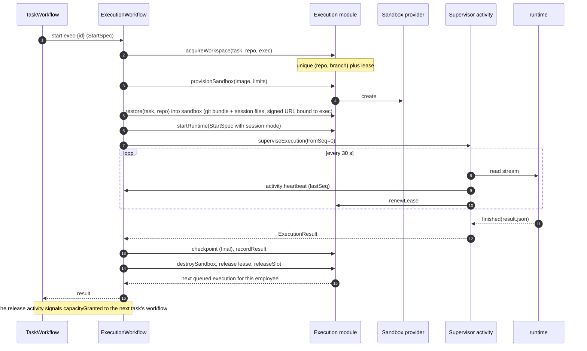
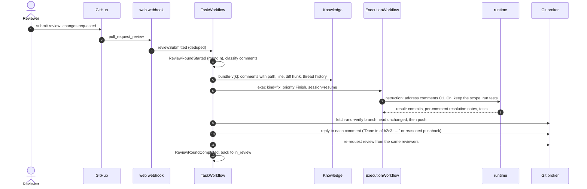

# Task Lifecycle

Status: **Approved** 2026-11-23 (decisions in [core-orchestrator-design.md §17](core-orchestrator-design.md)) · Part of the Core Orchestrator design set. Labels and source abbreviations are defined in [core-orchestrator-design.md §0](core-orchestrator-design.md).

**Covers:**

- Responsibility 4: planning and execution lifecycle.
- Responsibility 6: multiple tasks for one employee.
- Responsibility 9: failures, retries, timeouts and interrupted sessions.
- Responsibility 10: the PR review feedback loop.
- The QA hand-off.

---

## 1. Principles

**[Existing]**

- One TaskWorkflow per task (`task-{id}`). Temporal owns progress; `tasks.state` is a projection (AR SB-4).
- One execution at a time per task. One task per branch (REF §A).
- The agent never decides what happens next; it returns a result. The workflow decides (TA §1).
- Waiting costs nothing: no sandbox runs while the task waits for people (PRD FR-COL-1).
- Hand back rather than ship weak work (PRD §4).

**[Proposed]**

- **Finish before start.** Work that brings an open PR closer to merge is admitted ahead of new work. Why: reviewers are already waiting, and every open PR adds coordination cost for humans.
- **Every state has an exit timer.** A task is never waiting without a scheduled reminder, escalation or watchdog.

---

## 2. Task state machine

### 2.1 Canonical states [Proposed, Resolves C-3]

| State                | Meaning                                                                      | Sandbox running? | Holds an execution slot? |
| -------------------- | ---------------------------------------------------------------------------- | ---------------- | ------------------------ |
| `requested`          | Created, acknowledged, owner set                                             | No               | No                       |
| `checking_readiness` | Context being assembled; readiness check running                             | No               | No                       |
| `clarifying`         | Waiting on one or more **blocking** consultations, before or during the work | No               | No                       |
| `queued`             | An execution is waiting for capacity (any kind)                              | No               | No (waiting for one)     |
| `planning`           | Plan execution running (read-only)                                           | Yes              | Yes                      |
| `awaiting_approval`  | Waiting for a plan or action approval                                        | No               | No                       |
| `building`           | Build or fix execution running                                               | Yes              | Yes                      |
| `in_review`          | PR open; waiting for CI, reviews or merge                                    | No               | No                       |
| `in_qa`              | Handed to QA; waiting for the result                                         | No               | No                       |
| `done`               | Completion criteria met                                                      | No               | No                       |
| `paused`             | A manager paused it, or the employee was suspended                           | No               | No                       |
| `blocked`            | An external dependency is unavailable (outage, Phase 4 dependency)           | No               | No                       |
| `handed_back`        | Returned to the requester with analysis (terminal unless retried)            | No               | No                       |
| `cancelled`          | Cancelled by an authorized person (terminal)                                 | No               | No                       |

### 2.2 Mapping from the existing documents

| Existing                                                     | Source | Canonical                                                                                |
| ------------------------------------------------------------ | ------ | ---------------------------------------------------------------------------------------- |
| `requested`, `assigned`                                      | TA §9  | `requested` (the owner is set at creation, so `assigned` is redundant; see core doc C-9) |
| `checking_readiness ⇄ clarifying`                            | TA §9  | Unchanged; `clarifying` is now also reachable from `building` (REF §C)                   |
| "Extra tasks wait in queued"                                 | REF §A | `queued` (new task state)                                                                |
| `awaiting_approval`, `building ⇄ in_review`, `in_qa`, `done` | TA §9  | Unchanged                                                                                |
| `handed_back`, `blocked`, `cancelled`                        | TA §9  | Unchanged; `paused` added                                                                |
| Intake, PolicyCheck, Context, Readiness                      | WD 8   | `requested` → `checking_readiness`                                                       |
| Executing, Verifying, WaitingDependency                      | WD 8   | `building`, `in_review`, `blocked`                                                       |

### 2.3 State diagram

**Why `queued` sits in front of every execution, rather than once per task:** capacity is held only while a sandbox runs (§5). A task that comes back from review needs a slot again. Showing `queued` honestly tells the PM why nothing is happening.

**Why `clarifying` is reused mid-build, not a new `waiting_on_human`:** the meaning is the same (blocked on a person's answer). Reusing it keeps metrics like "time spent clarifying" and the dashboard filters simple. The consultation records tell you whether it was before or during the build.

---

## 3. The lifecycle, phase by phase

### 3.1 End-to-end sequence (PF-3106, happy path with one question and one review round)

### 3.2 Phase details

| Phase             | What happens                                                                                                                                                                                                                                                                            | Inputs                        | Outputs                                | Exit conditions                                                   | Label                                                       |
| ----------------- | --------------------------------------------------------------------------------------------------------------------------------------------------------------------------------------------------------------------------------------------------------------------------------------- | ----------------------------- | -------------------------------------- | ----------------------------------------------------------------- | ----------------------------------------------------------- |
| **Acknowledge**   | First activity: a thread reply that echoes the understood ticket and target                                                                                                                                                                                                             | Intake payload                | `side_effects` key `task:{id}:ack`     | Always continues                                                  | [Existing] PRD §6 (10 s); placement [Proposed]              |
| **Intake checks** | Employee active. Requester holds `assign_work`. Effective permissions resolved for the task scope. Completion criteria set from defaults if absent                                                                                                                                      | Task row, grants              | Task scope (repos, tools, actions)     | Missing grant → `awaiting_approval` (grant request) or hand back  | [Existing] TA §6                                            |
| **Context**       | `assembleContext(task, purpose)`                                                                                                                                                                                                                                                        | Jira, Figma, registry, memory | `bundle-v{n}` + manifest               | Required source down → `blocked`                                  | [Existing] TA §6; details in core doc §5                    |
| **Readiness**     | A structured model call with no tools: is there enough to start? Returns missing information as questions, each with a suggested owner                                                                                                                                                  | Bundle brief                  | Ready, or a list of questions          | Questions → consultations (blocking) → `clarifying`               | [Existing] TA §6; questions as consultations [Proposed]     |
| **Plan**          | Execution `kind=plan`, read-only sandbox, **new session**. The agent explores the repo and writes `plan.json`: steps, files, risks, tests to add, approvals needed, out-of-scope items, confidence                                                                                      | Bundle, repo clone            | `plan.json`, checkpoint                | Low confidence → hand back. Approval needed → `awaiting_approval` | [Existing] TA §6, WD 7                                      |
| **Plan approval** | Off by default. Required when `plan_approval.required` is set for the org, team or repository, when the repository is marked sensitive, or when the plan touches a path in `plan_approval.sensitive_paths` (core §18.1). Chat card to the requester's manager or the policy's approvers | Plan                          | `approvals` row                        | Rejected or expired → hand back with the plan attached            | [Existing] TA §8; [Approved] D-7                            |
| **Build**         | Execution `kind=build` in a fresh sandbox, restored from the task's checkpoint; **session resumed**. The agent implements, runs tests and collects evidence                                                                                                                             | Plan, bundle                  | `result.json`, local commits, evidence | See §3.3                                                          | [Existing] TA §6                                            |
| **Publish**       | Broker activities in order: push branch; find or create PR (template, evidence, Jira link); Jira comment and transition; thread summary                                                                                                                                                 | Result                        | PR ref in `task_links`                 | Push rejected → §6. PR exists → adopt it                          | [Existing] WD 10; publisher = workflow [Proposed, core C-6] |
| **Verify**        | Wait for CI and reviews. Evaluate completion criteria                                                                                                                                                                                                                                   | Webhook signals               | —                                      | §7, §8                                                            | [Existing] TA §6                                            |
| **Complete**      | Criteria met → `done`. Summary in thread. Jira transition. Learnings to memory. Outcome record. Release the workspace lease                                                                                                                                                             | Timeline                      | TaskCompleted                          | —                                                                 | [Existing] TA §6; REF §G                                    |

### 3.3 How the workflow interprets a build result [Proposed]

| `result.status`   | Condition                                                 | Next step                                                                                                                                                                              |
| ----------------- | --------------------------------------------------------- | -------------------------------------------------------------------------------------------------------------------------------------------------------------------------------------- |
| `completed`       | Tests pass, confidence ≥ threshold                        | Publish                                                                                                                                                                                |
| `completed`       | Required tests failing, or confidence < threshold         | One fix execution with the failures as the instruction. If still failing: hand back with a **draft** PR offered in the thread, opened only if the requester says yes [Decision needed] |
| `blocked`         | Questions present                                         | Consultations; `clarifying` if any question is blocking                                                                                                                                |
| `limit_reached`   | Plan steps advanced since the last execution              | One continuation execution (resume)                                                                                                                                                    |
| `limit_reached`   | No progress                                               | Hand back with analysis                                                                                                                                                                |
| `cannot_complete` | —                                                         | Hand back with the agent's analysis (TA §6)                                                                                                                                            |
| `interrupted`     | Reason from the workflow (cancel, pause, new instruction) | Follow the reason (§6.4)                                                                                                                                                               |
| `failed`          | Runtime or infrastructure error                           | Retry rules in §6.3                                                                                                                                                                    |

`scopeChanges[]` in the result → a message to the requester asking whether to include them now, as a follow-up task, or not at all. The current task never silently grows.

---

## 4. Execution lifecycle (inside ExecutionWorkflow)

**[Existing]** REF §A (workspace, lease, checkpoint, restore), TA §7 (sandbox setup), SS (execution states). **[Proposed]** order and the `interrupted` status.

"succeeded" means _the execution ended cleanly with a result_. Whether the task made progress is the TaskWorkflow's call (§3.3).

---

## 5. Managing several tasks for one employee (responsibility 6)

### 5.1 What is isolated per task

**[Existing]** REF §A:

| Per task             | Mechanism                                                                    |
| -------------------- | ---------------------------------------------------------------------------- |
| Control flow         | Its own TaskWorkflow; signals queue in arrival order                         |
| Claude session       | An `agent_sessions` row per (task, assignment); never shared                 |
| Workspace and branch | `task_workspaces` per (task, repository); unique (repository, branch); lease |
| Sandbox              | Fresh per execution; never reused across tasks                               |
| Context              | `bundle-v{n}` under the task's object prefix                                 |
| Credentials          | Execution-scoped leases (TA §11)                                             |
| Budget               | `tasks.budget_usd` (effective = min with the org per-task limit, core C-18)  |

### 5.2 Admission control [Proposed, Resolves C-2 and C-24]

**[Approved D-2] Unit of capacity = a running execution (a live sandbox), not an open task.** `ai_profiles.max_concurrency` (default 2) caps an employee's running executions. `org_limits.max_concurrent_executions` caps the org's.

**Why:**

- A task waiting for review, QA or a human answer uses no compute. Counting it as "busy" would idle the employee for days while PRs wait.
- A real engineer also has several PRs in review while coding one thing.
- REF §A already says "caps active executions". TA §7's "2 tasks" is read as shorthand.

**Optional guard:** `ai_profiles.max_open_tasks` (default 6, nullable). It limits how much open work an employee accepts. New requests beyond it are acknowledged and queued with a message ("I have 6 open tasks; I'll start this after PF-3101 merges, or ask @manager to reprioritise").

Why: without it, an employee could accumulate dozens of half-done PRs.

**Mechanism (no new table):**

1. `admit(taskId, kind, priority)` runs in one transaction. It locks the employee's `ai_profiles` row and counts that employee's `executions` with status `starting` or `running`, plus the org total.
   - If both are under their caps, it inserts the execution as `starting`.
   - Otherwise it inserts it as `queued`, writes `TaskQueuedForCapacity`, and returns the queue position.
2. The TaskWorkflow in `queued` waits for `capacityGranted`. **It also re-tries `admit` on a 5-minute timer**, so a lost wake-up only delays work, never strands it.
3. When an execution ends, `releaseSlot` picks the next `queued` execution for the same employee (and, if the org cap was the limit, for the org). It signals that task's workflow `capacityGranted`.
4. The queue position and estimated wait are posted in the task's thread (TA §12 backpressure). If the wait goes over 4 working hours, the employee's manager is told.

**Priority order** (highest first). Within a class: Jira priority, then age.

| Class       | Examples                                           | Why                                     |
| ----------- | -------------------------------------------------- | --------------------------------------- |
| 1 · Finish  | Review fixes, CI fixes, conflict rebases, QA fixes | Humans are waiting on a PR already open |
| 2 · Unblock | Resuming after an answer to a blocking question    | The requester engaged; keep momentum    |
| 3 · Build   | First build after a plan                           | —                                       |
| 4 · Plan    | New tasks' plan executions                         | Cheapest to delay                       |

**Quick answer runs** (status and general questions) need no sandbox, so they **never use an execution slot**. They are rate-limited per employee on the `act-model` queue. Why: being responsive in chat matters even when the employee is busy (PRD "behaves like a colleague").

### 5.3 Interactions between an employee's tasks

| Situation                                                        | Handling                                                                                                                                                                                                           | Label                     |
| ---------------------------------------------------------------- | ------------------------------------------------------------------------------------------------------------------------------------------------------------------------------------------------------------------ | ------------------------- |
| One message names two tasks ("finish PF-3106 and pause PF-3110") | Two `message_task_links`, two signals, each applied independently                                                                                                                                                  | [Existing] REF §B         |
| Two tasks in the same repository                                 | Different branches, both from the latest target branch at their first build. When one merges and the other's PR becomes unmergeable, a conflict webhook or check sends a `fix` execution with "rebase onto target" | [Proposed]                |
| Two tasks edit the same files                                    | Allowed; resolved at rebase. If the agent sees an overlap in its plan (open PRs touching the same files are in the bundle), it mentions it in the plan summary                                                     | [Proposed]                |
| A task depends on another of the employee's tasks                | Phase 4 (`task_dependencies`). In the MVP the agent may record a blocker, and the requester decides the order                                                                                                      | [Existing] phase          |
| Employee suspended                                               | TerminationWorkflow interrupts every running execution (each checkpoints) and moves tasks to `paused` or reassigns them per policy                                                                                 | [Existing] REF §E, TA §12 |
| Grant revoked on one repo                                        | Only executions using that repo are interrupted; other tasks continue                                                                                                                                              | [Existing] TA §12         |
| Org usage limit reached                                          | No new admissions. Running executions finish their current step and stop with `interrupted`                                                                                                                        | [Existing] TA §12         |

---

## 6. Failures, retries, timeouts and interruptions (responsibility 9)

### 6.1 Failure scenarios and recovery

| #   | Failure                                                     | Detected by                                                        | Recovery                                                                                                                                                                                                            | Counts as an agent attempt? | Label                                                                                     |
| --- | ----------------------------------------------------------- | ------------------------------------------------------------------ | ------------------------------------------------------------------------------------------------------------------------------------------------------------------------------------------------------------------- | --------------------------- | ----------------------------------------------------------------------------------------- |
| F1  | Transient external error (429, 5xx, network) in an activity | Activity error                                                     | Temporal retry, exponential backoff 1 s → 60 s, deadline per activity                                                                                                                                               | —                           | [Existing] TA §6                                                                          |
| F2  | Jira or Figma down during context assembly                  | Connector circuit breaker                                          | Partial bundle with flags. Required source missing → `blocked`, re-check every 10 min. After 24 h hand back                                                                                                         | No                          | [Existing] TA §12; timing [Proposed]                                                      |
| F3  | Model API errors inside the runtime                         | SDK retries; sustained errors end the execution `failed: provider` | Circuit breaker per provider pauses admissions (TA §12). Task back to `queued`. Fallback model only if policy allows                                                                                                | No                          | [Existing]                                                                                |
| F4  | Sandbox provisioning fails                                  | `provisionSandbox` error                                           | 2 retries with backoff. Then the execution fails `infra`; task back to `queued` with backoff. After 3 infra failures in an hour → `blocked: infra`, alert operators                                                 | No                          | [Proposed]                                                                                |
| F5  | VM crash, lost heartbeat                                    | Supervisor stream lost, provider reports the sandbox lost          | Attempt fails retryable. A **replacement sandbox** restores the latest checkpoint and resumes the session; work since the checkpoint is redone. The execution slot passes directly to the replacement (no re-queue) | Yes, up to 2 automatic      | [Existing] TA §6, REF §A; distinguished from F6 and from blocking questions in core §19.4 |
| F6  | Worker process dies mid-execution                           | Temporal activity timeout                                          | Supervisor activity rescheduled on another worker; reattaches to the same sandbox from `lastSeq`. **The sandbox never notices**                                                                                     | No                          | [Proposed] core C-20                                                                      |
| F7  | Runtime process crashes; the VM is alive                    | Stream ends without `finished`                                     | Treated like F5. The supervisor destroys the sandbox first                                                                                                                                                          | Yes                         | [Proposed]                                                                                |
| F8  | Turn, time or budget limit reached                          | `result.status = limit_reached`                                    | One continuation execution if progress was made, else hand back. Budget: stop, notify the manager, resume if raised                                                                                                 | Continuation: no            | [Existing] budget TA §6; continuation [Proposed]                                          |
| F9  | Agent says it cannot complete, or confidence is low         | Result                                                             | Hand back with analysis; offer the plan and the partial branch                                                                                                                                                      | —                           | [Existing]                                                                                |
| F10 | Push rejected: a human pushed to the branch                 | Broker error, non-fast-forward                                     | Fix execution: fetch, integrate the human's commits (**never force-push**), re-run tests                                                                                                                            | No                          | [Proposed]                                                                                |
| F11 | Push rejected: branch protection or policy                  | Broker policy check                                                | Approval request or hand back                                                                                                                                                                                       | —                           | [Existing] TA §6                                                                          |
| F12 | PR already exists for the branch                            | Check-before-create                                                | Adopt it, update the description                                                                                                                                                                                    | —                           | [Existing] TA §4                                                                          |
| F13 | Chat or Jira write fails                                    | Broker retry                                                       | Retry with backoff. The task continues. The dashboard shows "reply pending". Dead letter after 24 h                                                                                                                 | —                           | [Existing] TA §12, SS                                                                     |
| F14 | Branch lease stuck                                          | 3 missed lease renewals                                            | Reclaimed only after the provider confirms the old sandbox is destroyed                                                                                                                                             | —                           | [Existing] REF §A                                                                         |
| F15 | Checkpoint restore mismatch or corruption                   | Hash or commit check after restore                                 | Previous checkpoint → last pushed commit → base commit plus the task brief (redo). Each fallback is noted in the thread if work was lost                                                                            | No                          | [Existing] REF risks; order [Proposed]                                                    |
| F16 | Permission revoked mid-run                                  | `GrantRevoked` event                                               | Interrupt; leases revoked; proxy routes blocked within 60 s. Then request approval or hand back                                                                                                                     | —                           | [Existing] TA §11, §12                                                                    |
| F17 | Employee suspended                                          | `MemberSuspended`                                                  | §5.3                                                                                                                                                                                                                | —                           | [Existing]                                                                                |
| F18 | Human never answers                                         | Consultation timers                                                | Reminder → escalate → hand back ([human-collaboration-flow.md](human-collaboration-flow.md))                                                                                                                        | —                           | [Existing] REF §C                                                                         |
| F19 | Workflow code bug or non-determinism                        | Workflow task failures                                             | Temporal keeps retrying the workflow task; an alert fires. Fix with a patched deploy; the task resumes where it was. **Never terminate and restart a task workflow**                                                | —                           | [Proposed]                                                                                |
| F20 | Temporal Cloud unavailable                                  | Start or signal fails in web                                       | Webhook returns 5xx, so Google, GitHub and Atlassian redeliver. Chat thread reconcile poll catches gaps                                                                                                             | —                           | [Proposed]; poll [Existing] TA §12                                                        |
| F21 | Postgres unavailable                                        | Activity errors                                                    | Activities retry; webhooks return 5xx                                                                                                                                                                               | —                           | [Proposed]                                                                                |
| F22 | Duplicate or replayed webhook                               | `inbound_deliveries`                                               | Dropped. Workflows also keep a bounded set of handled event ids per signal type                                                                                                                                     | —                           | [Existing] TA §4; in-workflow set [Proposed]                                              |
| F23 | Usage limit reached                                         | Admission                                                          | §5.3                                                                                                                                                                                                                | —                           | [Existing]                                                                                |

### 6.2 Timeouts [Recommended defaults, Decision D-10]

| Timer                                     | Value                                                           | On expiry                                                               |
| ----------------------------------------- | --------------------------------------------------------------- | ----------------------------------------------------------------------- |
| Acknowledgement                           | 10 s SLO (PRD)                                                  | Alert                                                                   |
| Classifier call                           | 5 s                                                             | Rules only, plus an "ambiguous" prompt (REF §B)                         |
| Context assembly                          | 3 min                                                           | Partial bundle with flags                                               |
| Readiness check                           | 60 s                                                            | Retry once, then proceed to planning (the plan will surface gaps)       |
| Sandbox provisioning                      | 3 min                                                           | F4                                                                      |
| Plan execution wall clock                 | 20 min                                                          | `limit_reached`                                                         |
| Build execution wall clock                | 90 min (SS example 5400 s)                                      | `limit_reached`                                                         |
| Fix execution wall clock                  | 45 min                                                          | `limit_reached`                                                         |
| Supervisor heartbeat                      | Every 30 s; timeout 2 min                                       | F5 or F6                                                                |
| Branch lease                              | Renewed every 30 s; expires after 90 s (3 missed)               | F14                                                                     |
| Checkpoint                                | Each plan step, and at least every 10 min (REF §A)              | —                                                                       |
| Interrupt grace                           | 60 s                                                            | Kill; the last periodic checkpoint is used                              |
| Consultation reminder, escalation, expiry | 4 working hours / 1 working day / then hand back (REF §C)       | See the collaboration doc                                               |
| Approval expiry                           | 24 h (WD 14)                                                    | Treated as rejection (TA §8)                                            |
| Review debounce                           | 3 min quiet window, or immediately on "review submitted"        | Start the fix round                                                     |
| Waiting for first review                  | Nudge after 1 working day; tell the requester after 2           | —                                                                       |
| Waiting for merge after approval          | Nudge the requester after 1 working day                         | —                                                                       |
| QA wait                                   | Reminder after 1 working day; escalate to the team lead after 3 | After 5 working days: the employee's manager, with options (core §19.3) |
| CI pending after publish                  | No status within 2 h                                            | Poll the provider; still none → tell the requester                      |
| Paused                                    | 3 working days                                                  | Remind the person who paused; then the employee's manager               |
| Queued for capacity                       | Tell the manager after 4 working hours                          | —                                                                       |
| Step watchdog                             | 2× the expected duration of any state                           | Notify the owner's manager with retry, reassign or hand back (TA §12)   |

"Working hours" use the asked person's working hours and time zone, from their Google Calendar where available, otherwise the org default.

### 6.3 Retry budgets and loop limits [Proposed, Resolves C-21]

| Budget                                            | Limit                                             | Then                                                                       |
| ------------------------------------------------- | ------------------------------------------------- | -------------------------------------------------------------------------- |
| Automatic resume after a crash (F5, F7)           | 2 per execution intent (TA §6)                    | Hand back with logs                                                        |
| Continuation after `limit_reached` with progress  | 1 per execution intent                            | Hand back                                                                  |
| Infrastructure retries (F3, F4, F6)               | Do not count against the agent                    | Operator alert after 3 per hour                                            |
| CI fix attempts                                   | 2 per distinct failing check                      | Ask the requester; may be flaky or an environment issue                    |
| Review rounds                                     | Escalate after round 4                            | Message to the requester and the reviewer, asking for a call or a decision |
| Total executions per task (excluding answer runs) | 12                                                | Manager notified with options: raise the limit, reassign, hand back        |
| Budget                                            | Effective = min(task, org per-task); warn at 80 % | Stop at 100 % (TA §6)                                                      |

**Why these limits:** the existing docs bound only crash retries. Review and CI loops can cycle forever and spend the budget quietly. Visible limits plus a human decision match how a real team would escalate a stuck PR.

### 6.4 Interrupted executions (orderly stops)

An interruption is an orderly stop requested by the platform. It is **not** a failure and does not consume a retry.

| Reason           | Sent when                                                                                      | After the interruption                                                                |
| ---------------- | ---------------------------------------------------------------------------------------------- | ------------------------------------------------------------------------------------- |
| `newInstruction` | A large requirement change arrives mid-run ([session-management.md §5](session-management.md)) | Rebuild the bundle; new execution, session resumed with the change as its instruction |
| `cancel`         | Cancel Update                                                                                  | `cancelled`; thread told; branch kept for 14 days, then deleted [Decision needed]     |
| `pause`          | Manager pause, or employee suspended                                                           | `paused`; resume restarts from the checkpoint                                         |
| `revoke`         | Grant revoked                                                                                  | Approval or hand back                                                                 |
| `limit`          | Org usage limit                                                                                | `queued` once the limit is raised                                                     |
| `shutdown`       | Sandbox provider maintenance or a planned drain                                                | `queued` at high priority                                                             |

Flow:

1. The TaskWorkflow sends `interrupt` to `exec-{id}`.
2. The supervisor calls `Interrupt(reason, grace = 60 s)`.
3. The runtime lets the current tool call finish. It then writes a checkpoint (git bundle, session files, brief) and exits with `interrupted`.
4. If the grace period passes, the sandbox is destroyed and the last periodic checkpoint is used.
5. The session stays `idle`, so it can be resumed.

### 6.5 Cancel, reassign, retry

| Action                                      | Effect                                                                                                                                                                                                                                                           |
| ------------------------------------------- | ---------------------------------------------------------------------------------------------------------------------------------------------------------------------------------------------------------------------------------------------------------------- |
| **Cancel**                                  | Interrupt any execution. Close consultations with a "no longer needed" message. Leave the PR open with a comment, or close it per the team setting. `TaskStateChanged → cancelled`                                                                               |
| **Reassign to another AI employee**         | Interrupt and checkpoint. Increment `tasks.assignment_no`. The new owner gets a **fresh session** seeded with the brief ([session-management.md §3](session-management.md)), the same branch and workspace, and a new lease. Thread announcement. `TaskAssigned` |
| **Reassign to a human**                     | The same, minus the session. The PR and branch are left for the human; the TaskWorkflow ends with `handed_back` (the human's work is tracked in Jira)                                                                                                            |
| **Retry** (from `handed_back` or `blocked`) | Re-enter at `checking_readiness`, with the hand-back analysis in the bundle                                                                                                                                                                                      |

---

## 7. PR review feedback loop (responsibility 10)

**[Existing]** PRD FR-ENG-4 ("respond to PR review comments with new commits"), TA §6 ("review comments arrive as signals and start fix attempts"), WD 10. **[Proposed]** everything below [Resolves C-22].

### 7.1 Inputs

| Source                                                 | Webhook (GitHub; Bitbucket equivalent)                                         | Signal                                       |
| ------------------------------------------------------ | ------------------------------------------------------------------------------ | -------------------------------------------- |
| A review submitted (approve, request changes, comment) | `pull_request_review.submitted`                                                | `reviewSubmitted`                            |
| A single comment outside a review                      | `pull_request_review_comment`, `issue_comment` on the PR                       | `prCommentAdded`                             |
| CI                                                     | `check_suite.completed`, `check_run.completed` (or the Bitbucket build status) | `ciStatusChanged`                            |
| Mergeability or conflict                               | `pull_request.synchronize` / mergeable state on poll                           | `ciStatusChanged` (kind `conflict`)          |
| Merge or close                                         | `pull_request.closed`                                                          | `prMerged` / `prClosed`                      |
| Human pushes to the branch                             | `push` on the work branch, by someone other than the employee                  | `instructionReceived` (kind `branchUpdated`) |

The webhook route dedupes by delivery id (TA §4). It then resolves the task from `task_links (kind = pull_request)` and signals it.

### 7.2 Which feedback counts

| Author                                                                 | Treatment                                                                                                    |
| ---------------------------------------------------------------------- | ------------------------------------------------------------------------------------------------------------ |
| Humans with write access to the repo, or listed in `repository_owners` | Actionable                                                                                                   |
| The PR's requester or the task's requester                             | Actionable                                                                                                   |
| Other humans                                                           | Acknowledged; questions answered; change requests only after an actionable reviewer agrees [Decision needed] |
| Bots (linters, coverage, security scanners)                            | Their failing **checks** are actionable through CI. Their comments are informational                         |
| The employee itself, or other AI employees                             | Ignored by the loop. Phase 4 adds AI reviewers (FR-ENG-5)                                                    |

Review text is untrusted input (TA §11). It can change code only within the task's grants. It cannot change the task's scope, permissions or target branch without the requester confirming.

### 7.3 Batching and classification

1. **Debounce.** A `reviewSubmitted` event starts the round immediately; a review is the reviewer's batch. Loose `prCommentAdded` events start a 3-minute quiet-window timer that resets on each new comment. Why: reviewers often post several comments in a row, and one fix execution per batch is cheaper and produces one coherent push.
2. **Classify each comment** with one structured model call over the batch:
   - `change_request`
   - `question`
   - `nit` (optional change)
   - `praise_or_ack`
   - `out_of_scope` (a good idea, but not this task)
3. **Plan the round:**
   - Questions alone → an **answer run** (no sandbox if the answer needs no code reading; otherwise a short read-only `review_reply` execution) that replies on the PR.
   - Any change requests or nits → a `fix` execution.
   - Out-of-scope items → a reply proposing a follow-up task, and a thread note to the requester.

### 7.4 The fix round

**Rules:**

- **Per-comment accountability.** The result maps every actionable comment to `addressed` (with a commit sha), `declined` (with a reason), or `question` (needs the reviewer). Replies are idempotent: side-effect key `task:{id}:pr-reply:{commentId}:{round}`.
- **Pushback is allowed.** If the agent believes a request is wrong (it breaks a test or contradicts the ticket), it replies with its reasoning and does not change the code. This is how a good engineer behaves, and the reviewer stays in control.
- **Resolving threads is left to reviewers.** The employee replies but does not resolve. Why: resolving someone else's comment is a social signal that teams care about.
- **Branch head check before push.** If someone pushed meanwhile (F10), the employee integrates their commits first.
- **CI after the push** flows back through `ciStatusChanged`. A failure starts a CI fix (limit 2 per failing check, §6.3).
- **Conflict** with the target branch → `fix` execution with "rebase onto target". It uses merge or rebase per the repo's convention from memory (L4), and **never force-pushes** without approval (TA §8 default policy pack).
- **Round limit:** after round 4, escalate (§6.3).
- **PR closed without merge** → ask the requester: abandon (cancel), or reopen with changes? The task waits in `in_review` with a reminder.

### 7.5 Completion criteria [Approved D-6]

- Default: `pr_opened` ∧ `ci_green` ∧ `pr_approved` ∧ `pr_merged`. QA (`qa_passed`) is optional.
- **Configurable per organization, team and repository** (`completion.criteria`; the most specific scope wins, core §18.1). For example, a team may add `qa_passed` (§8), or drop `pr_merged` when merging is a release manager's job; the task is then done at approval.
- The resolved criteria are **pinned in `tasks.settings_snapshot` when the task is created**, so a settings change never moves the goalposts of a task already in review.
- The review loop limits in §7 (debounce, rounds, actionable reviewers) are configurable defaults at the same scopes, and are pinned the same way.

---

## 8. QA hand-off [Proposed, Resolves C-15]

The PRD promises "ownership of work through review and QA", and TA §9 has an `in_qa` state, but no flow exists. Proposal:

| Item       | Design                                                                                                                                                                                                                                                                 |
| ---------- | ---------------------------------------------------------------------------------------------------------------------------------------------------------------------------------------------------------------------------------------------------------------------- |
| When       | `qa_passed` is in the completion criteria, and the team's `qa_stage` setting is met: `pre_merge` (PR approved + CI green + preview available) or `post_merge` (merged and deployed to staging; deploy detection from a Jira transition or a deploy webhook in Phase 4) |
| Who        | The team's QA owner from team settings, else the Jira issue's QA field or assignee rule, else the requester                                                                                                                                                            |
| How        | Brokers: Jira transition to the team's "Ready for QA" status; thread message tagging the QA owner with the preview URL, a test summary, screenshots and the acceptance criteria checklist                                                                              |
| Waiting    | State `in_qa`; event `TaskQaRequested`; reminders per §6.2                                                                                                                                                                                                             |
| Result     | `qaResult` signal from a Jira transition webhook ("QA Passed" or "Reopened"), or from chat intake (the QA owner replies in the thread, classified as task_update with a pass or fail)                                                                                  |
| Failure    | QA notes → bundle → `fix` execution at Finish priority → back through review if code changed → `in_qa` again. Counted for the rework metric (REF §G); `TaskQaResulted` carries pass or fail                                                                            |
| After done | Bugs found after `done` create a **new task linked with `follows`**, never reopen the old one. This matches REF §G's rework definition ("follow-up fix tasks within 14 days")                                                                                          |

---

## 9. Completion and learning

**[Existing]** TA §6, REF §G. **[Proposed]** details:

1. `recordTaskState(done)` and `TaskCompleted` (outbox), in one transaction.
2. Brokers: a final thread summary (what changed, PR, how it was tested, follow-ups), and a Jira transition.
3. **Learnings.** A model call over the task timeline proposes up to 3 L4 memory items, for example "repo X: run `pnpm test:unit`, not `pnpm test`", or "the PM prefers relative timestamps". Each has a source reference. Items about team preferences need the manager's approval in the dashboard before they apply [Decision needed]. Why: memory changes future behaviour for everyone on the team.
4. The `task_outcomes` row is written by the existing outbox handler (REF §G).
5. Session → `idle`, then `expired` after retention. The workspace lease is released. Snapshots are deleted after the retention period (default 14 days after done) [Decision needed].

---

## 10. Data written along the lifecycle

| Phase            | Tables (owner module)                                                                                      |
| ---------------- | ---------------------------------------------------------------------------------------------------------- |
| Intake           | `messages`, `message_task_links`, `tasks` (+`source_message_id`), `task_links` (Conversations, Work)       |
| Every transition | `tasks.state`, `state_version`; `outbox_events` (Work, Platform)                                           |
| Context          | Bundle objects; `executions.bundle_version` when used (Knowledge, Execution)                               |
| Plan, build, fix | `executions`, `execution_logs`, `agent_sessions`, `task_workspaces`, `usage_records` (Execution, Platform) |
| Questions        | `consultations`, `pending_questions` (Work, Conversations)                                                 |
| Approvals        | `approvals` (Work)                                                                                         |
| Publish, replies | `side_effects`, `task_links (pull_request)` (Orchestration, Work)                                          |
| Review rounds    | `tasks.pr_review_round`; ReviewRound events (Work)                                                         |
| Done             | `task_outcomes`, `memory_items` (Platform, Knowledge)                                                      |

## 11. Decisions

**Approved** (core §17): D-2 capacity, D-5 state machine, D-6 configurable completion criteria, D-7 plan approval for sensitive repositories and paths, D-9 configurable review limits, D-10 retry and timeout policies, D-15 hand-back threshold 0.6. Configuration keys and scopes are listed in [core-orchestrator-design.md §18](core-orchestrator-design.md).

**Still open:** U-3 draft PR when tests still fail; U-4 branch and PR on cancel; U-5 non-owner change requests; U-6 approval of learnings; U-7 snapshot retention; U-14 CI re-run heuristic ([core §20](core-orchestrator-design.md)).
